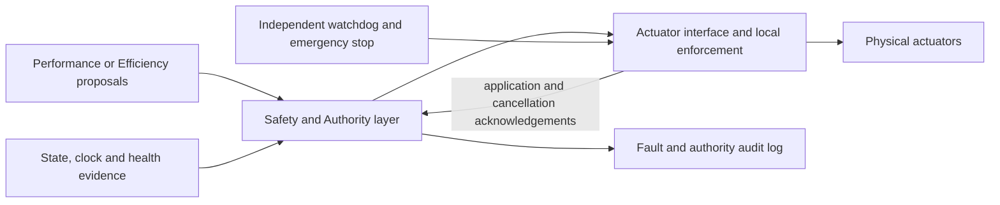

# S0 — Shared Safety, Recovery and Fault Supervision

**WORK_COMPLETE_PENDING_REVIEW — specification and hazard analysis only.**
Authority: Primary APEX Scientific Decisions, 17 October 2026. This proposal is for one shared
layer serving accepted Performance and future Efficiency controllers. No policy, runtime
interface, fault injector, watchdog, hardware device or safety guarantee is implemented here.

The isolated `research/safety-s0` branch starts at accepted E4
`48adbdf64d492592d15e23c917aca71fa58aa8a5`. Frozen Performance refs, main and the independent
Efficiency branch remain unchanged. This specification is not merged into either controller.
It does not revise the accepted synthetic profile or authorize the next implementation stage.

## 1. Evidence and implemented boundary

Immutable foundations:

- [E1 fallback-domain audit](https://github.com/Maxrwan/MPC_Controller_v1_IronManStyle/blob/835eefb0aafe2f982a0ba05847d4e731079ff52d/docs/TASK007E1_FALLBACK_DOMAIN_AUDIT.md).
- [E3 formal verification](https://github.com/Maxrwan/MPC_Controller_v1_IronManStyle/blob/ecbbc5cdb6d182557dfdd0bca7caa215cc1355c9/docs/TASK007E3_PERFORMANCE_VERIFICATION.md): 750 historical passes at `e603672b209985f11ed26b6f44d3949ffd5675c5`, 633.76 s. Not rerun or applied to unimplemented Safety behavior.
- [E4 Primary acceptance](https://github.com/Maxrwan/MPC_Controller_v1_IronManStyle/blob/48adbdf64d492592d15e23c917aca71fa58aa8a5/docs/task007e/e4/primary_acceptance.json): bounded synthetic Architecture A under Recommendation B, not hardware safety acceptance.
- [F0 Efficiency specification](https://github.com/Maxrwan/MPC_Controller_v1_IronManStyle/blob/eaa0a3398515a21f30a850de59a0b44c775fad4d/docs/TASK007F0_EFFICIENCY_SPEC.md), including its separate [temporal-grid audit](https://github.com/Maxrwan/MPC_Controller_v1_IronManStyle/blob/eaa0a3398515a21f30a850de59a0b44c775fad4d/docs/task007f/f0/temporal_grid_audit.md).

[Provenance](safety/s0/provenance.json) binds those documents and inspected implementations with
Git revisions and SHA256. Scientific VIS execution remains `8dbd1c5fbc09781411fc762e04f9c2c5cf2d99ae`;
S0 is not a new scientific execution. The accepted manifest bytes and historical proposal flags
remain untouched; E4 remains the authoritative subsequent acceptance.

| Current implementation | Verified scope and limitation |
|---|---|
| [AsyncRunner](../src/apex/simulation/asynchronous.py), exhaustion and idle fallback computation | Admission requires inclusive `1 <= vx <= 3` m/s and vehicle center inside `[-right_width,left_width]`. This is not a verified recovery basin or footprint clearance condition. |
| [Baseline controller](../src/apex/control/baseline/controller.py), [LQR](../src/apex/control/baseline/lqr.py), [PI](../src/apex/control/baseline/speed.py) | Centerline and 2 m/s reference; small-slip linear design with 1/2/3 m/s gain nodes and clamped design speed. Finite/limit checks do not prove nonlinear recovery. PI is not a standstill controller. |
| [Buffer](../src/apex/control/trajectory/packet.py) | Rejects failed/stale/unavailable/insufficient-reserve packets; fixed deadlines additionally restrict eligibility. Runtime sampling rejects exhausted authority. Packet interpolation is not extrapolation or interpolated ownership. |
| Buffer reserve | Healthy at >=0.20 s; warning below 0.20; critical below 0.05; exhausted at <=1e-10 s numerical tolerance. Minimum handoff reserve 0.05 s. These are existing telemetry/acceptance conventions, not certified intervention times. |
| Async fallback latch | No automatic racing reentry or guaranteed rescue. Old pending actuator work survives; baseline computation waits while codriver is busy. Fallback admission is not independently rechecked at every delayed application. |
| [Physical dynamic model](../src/apex/models/vehicle/dynamic_bicycle.py) | State/input, tire/load, Frenet and RK4 stage/end checks protect declared synthetic model validity. Dynamic speed minimum is 0.5 m/s; no automatic low-speed switch. Recorded application is not proof of later validated propagation. |

Frozen event order is due actuator application → preparation completion → waiting/fixed packet
eligibility/acceptance or miss → disturbance/exhaustion/fallback admission → codriver busy/update
→ nominal/eligible urgent release → held-input validation and physical propagation. A completed
solve is not accepted authority. Fixed misses do not cancel a busy solve. Old-source pending
commands retain their identity across handoffs. These semantics and historical tests are not
changed by S0; a future stronger endpoint contract needs separately reviewed integration.

Measured C70 provides the motivation, not a diagnosis of host-runtime root cause: 485 releases,
455 acceptances, 30 deadline misses (22 followed by accepted recovery, eight terminal misses).
Packet 477 expired at 48.670 s; terminal reserve was zero and vx=5.960492971 m/s, outside baseline
admission. `exhausted_outside_baseline_domain` stopped the simulation before baseline computation.
Packets 478–484 never activated; 485 completion/discard is censored. The later NumPy boolean export
failure is separate; no failed package is repaired or relabeled here. See immutable E3 above.
Architecture A completed the retained controlled/measured laps; exhaustion remains possible from
sustained delays, failed prediction/preparation or repeated rejection, not an observed VIS A failure.
**Stopping a synthetic loop is not physical emergency braking.**

## 2. Proposed separation of responsibility

| Owner | Proposed responsibility |
|---|---|
| Controller / codriver | Generate proposals with immutable source, timing and feasibility evidence. Never self-grant physical authority. |
| Safety supervisor | Validate state/clock information, packet authority and reserve; evaluate response feasibility; classify faults; grant/revoke bounded permissions; arbitrate recovery/deceleration/stop; latch faults and report unknowns. |
| Validated recovery/stop policy | Separate future producer with its own domain, constraints and terminal/transfer condition. Existing fallback is not presumed eligible for this role. |
| Actuator endpoint | Independently enforce session, epoch, sequence, freshness, time limits and characterized actuator behavior; acknowledge actual application/cancellation; supervise held input even if host is silent. |
| Independent watchdog / e-stop | Detect lost progress and request/enforce a characterized local emergency response without relying solely on the supervised host. Logical separation alone does not prove physical independence. |
| Operator / Engineering | Approve domains, residual risk, arming and reset/reentry policy. An operator reset cannot override invalid domain evidence. |

The supervisor uses canonical `[vx,vy,r,e_psi,s_abs,e_y]` in `[m/s,m/s,rad/s,rad,m,m]` and
`[delta,a_cmd]` in `[rad,m/s²]`. Frenet conventions and original source/map identity remain fixed.
Physical actuator conversion is a future calibrated interface, not an invented tire or braking law.
Software grants and physical enforcement are separately observed. Loss of the software layer,
communications or power must not be hidden by continued logs or an unverified heartbeat.

## 3. Hazards, state machine and escalation

The [hazard register](safety/s0/hazard_register.json) contains H01–H14: exhaustion, fixed misses,
planner busy, solver failure, localization faults, delayed/replayed commands, pending mode-crossing
commands, sensor uncertainty, communication loss, overload/crash, grip/saturation, corner/boundary
faults, actuator/power faults and emergency requests/inability to stop. Every entry supplies cause,
consequence, signals, response, domain, timing requirement, residual risk, synthetic scenario and
hardware dependencies. Signals not present in the simulator are explicitly proposed, not observed.
No numerical fault probability, guaranteed response time or stopping distance is assigned.

[Supervisor states](safety/s0/supervisor_states.json) define nine states and 14 transitions:

| State | Permission and transition intent |
|---|---|
| DISARMED | Refuse racing grants until fresh state, accepted authority, endpoint/session and health checks plus explicit arming. Disarmed actuator behavior needs characterization. |
| NORMAL | Continue current valid trajectory within the validated domain and bounded permission. |
| WARNING | Existing authority may continue while renewal and alternative response feasibility are assessed. Do not wait blindly until expiry. |
| RECOVERY | Admit only a separately verified policy when recovery is feasible and preferable to stopping. |
| DECELERATING | Execute a verified joint lateral/longitudinal conservative policy with a valid destination or stopping transfer. |
| STOP_REQUESTED | Latch emergency/stop demand and assess feasibility. A request is not an application acknowledgement. |
| STOPPING | Validated stop policy is acknowledged and monitored; loss of feasibility or acknowledgement escalates. |
| STOPPED_LATCHED | Independently confirmed rest and holding; no automatic restart. New session and admission after approved reset. |
| NO_VALID_POLICY | No acceptable policy or bounded application-state knowledge. Revoke unsupported grants, request only a characterized independent response, and explicitly report uncontrolled hazard. Never label an unknown physical outcome safe. |

Priority is valid continuation → timely renewal or admissible recovery → verified conservative
response → validated safe stop, with direct emergency escalation whenever required. Recovery is
not always safer than stopping. If neither is admissible, enter NO_VALID_POLICY without waiting
indefinitely for a stop acknowledgement. Revoking a software permission does not physically remove
a held input: the endpoint's local response must be characterized, and its absence remains a hazard.
No universal zero command, maximum brake or power cut is specified.

Emergency/critical faults outrank permissive transitions. Fault latches survive loss/restart of the
supervised process; persistence and power-failure handling need hardware design. Warning hysteresis,
recovery reentry dwell and intervention budgets remain unresolved requirements. Reentry requires a
verified terminal recovery region, fresh accepted authority, health and a reviewed transition; stop
and no-policy latches require explicit clearance, never a direct reset-to-racing shortcut.

## 4. Domain requirements, not invented controller equations

Let `X(t)` be a conservative set of possible physical states at decision/application time, derived
from timestamped measurements, uncertainty and motion during delay. Let `Theta`, `W`, `U_available`
and `Delta` denote validated parameter, disturbance, actuator and delay envelopes. They are **not
identified or numerically instantiated by S0**. Covariance alone is not automatically a guaranteed
bound; the chosen set/confidence interpretation and residual risk need Primary review.

The five domain IDs in [the interface](safety/s0/authority_interface.json) mean:

- **D_NOMINAL:** all applicable model/controller assumptions, state, actuator, geometry and timing
  constraints hold over the declared operating envelope. Solver convergence is insufficient.
- **D_PACKET:** a separately validated, accepted and available trajectory has strictly increasing
  actual timestamps, eligible handoff, valid identity and unexpired authority. Proposed authority
  intervals are `[start,expiry)`; uncertainty must not straddle either boundary. This is temporal/
  numerical eligibility, not proof of a safe physical reachable tube.
- **D_RECOVERY:** there exists a separately verified recovery policy for every state/parameter/
  disturbance/delay combination in the declared sets, staying within constraints and reaching a
  specified invariant region or verified transfer set. Admission rectangle `1..3 m/s + center inside`
  does not establish this existential/robust condition.
- **D_DECEL:** a verified joint steering/longitudinal policy can reduce speed and remain feasible
  through a specified destination or transfer to a stop policy, including uncertain grip, load and
  actuator capability. Negative `a_cmd` alone does not prove decreasing speed or safe cornering.
- **D_STOP:** a verified policy brings every allowed initial uncertainty to confirmed rest and holding
  within the available free swept space, under the declared faults and delays. Includes the entire
  low-speed transition and a valid terminal rest condition. S0 establishes no such set.

A future proof/validation obligation is reachable-set containment for **all** admitted uncertainty
and delay realizations over the whole response, not just at NLP nodes. For recovery, require a
validated terminal/transfer set; for stopping, require rest/holding and collision-free footprint
over the response. Use independently checked reachability or justified conservative envelopes,
identified models, model-discrepancy bounds and controlled validation. Finite sampled success alone
cannot establish a universal guarantee; state precisely which claims are proved versus sampled.

Necessary variables include vx/vy/r and sideslip, heading, progress/lateral error, curvature/Frenet
margin, footprint and obstacle/corridor geometry, axle loads/combined grip uncertainty, steering
angle/rate and braking force availability, power/actuator health, sensor/clock uncertainty, compute/
transport/actuation delays, actual reserve and available stopping space. Sideslip evaluation near
zero speed itself requires the future low-speed model. A scalar stopping-distance comparison is
only necessary, not sufficient: curved-path swept-body containment also matters.

**Braking boundary:** current synthetic `a_cmd >= -3 m/s²` is an input limit, not measured braking
capability. Dynamic `a_cmd=Fx_total/m` and `dvx/dt=a_cmd+r*vy`; no `v²/(2×3)` stopping claim follows.
The current combined-grip allocation is normal-load-proportional. Future rear-wheel motor drag
must use actual rear load, longitudinal/lateral combined grip, wheel-level braking distribution,
motor/controller dynamics, power state and uncertainty; it cannot inherit this synthetic allocation.
Current dynamic vx minimum 0.5 m/s excludes standstill. No stop-to-zero guarantee without reviewed
low-speed dynamics, hardware identification and Stage C/D validation. No domain expansion occurs here.

## 5. Timing, reserve and physical application contract

[Authority interface](safety/s0/authority_interface.json), candidate `apex-safety-authority/0.1.0`,
defines generation time, original controller/packet and model identity, state capture/receive time
and uncertainty, packet interval, requested/latest application, generation/current permission epochs,
bounded permission/held interval, transition/cancellation records and actual application feedback.
It is a proposed envelope, **not** a modification of TrajectoryPacket, apex-run exports or the runner.
Required-but-unknown information denies the dependent permission; it is never replaced with zero.
Require capture <= generation <= requested application <= actual application <= latest application
< permission end, actual application >= permission start, and held-until <= permission end. For
packet-derived commands, permission end cannot exceed original packet expiry, including after
reauthorization. Apply these comparisons conservatively over clock uncertainty; observation of an
acknowledgement may occur later and has its own timestamp.
Non-packet recovery commands need an explicit policy identity/domain and permission interval.

Use an authoritative monotonic physical/control clock and bounded mappings from other clocks.
Record reset/session identity and clock uncertainty. One-way transport, cancellation and feedback
latencies are separate from computation. Check capture age at actual application and during hold,
not merely at generation; propagate uncertainty without future plant truth.

`R(t)=max(0, t_expiry-t)` describes accepted trajectory reserve. Pending/waiting proposals contribute
no authority until accepted. A longer optimizer horizon or fewer stages does not imply longer usable
reserve or a verified stopping domain. The future intervention requirement must establish, with
margins and bounds, that detection + decision + transport + actuation can complete **before the
earliest loss of admissible continuation/response**. A conceptual necessary inequality is:

`T_detect + T_decide + T_transport + T_actuate + T_margin < t_loss - t_fault`.

Here `t_loss` is a conservatively established viability/authority boundary, not simply the next
solver's predicted finish. Clock error and cancellation latency belong in the bound; recovery/stop
feasibility must cover the subsequent motion as well. Unknown terms preclude a guarantee. Existing
0.20/0.05 s thresholds and F0 research criteria cannot substitute for this derivation.

Proposed application/held-input rules:

1. A feasible solution, accepted packet and physically permitted request are three different gates.
2. Validate current session/sequence/epoch, temporal interval, state uncertainty/domain, actuator
   health, actual previous input/time, slew and joint constraints immediately before physical commit.
   Bound the permitted hold interval; validate post-clamp input rather than assuming clipping is safe.
3. At the future arbiter, known emergency/revocation/expiry wins over permissive grant/commit.
   Serialize epoch change and commit; an acknowledgement records which occurred first. Unknown
   clock/order means no new permission. Fixed exact-deadline readiness precedes eligibility, while
   late fixed packets remain ineligible. This is an endpoint proposal, not a reordered frozen run.
4. Handoff does not erase an already applied input or change its original source ID. An in-flight
   old-source request may survive only with explicit current-epoch reauthorization after validation;
   otherwise revoke/cancel it. Preserve generation epoch/source plus new grant identity separately.
   Cancellation request is not cancellation acknowledgement; late cancellation cannot undo actuation.
5. Reject stale/replayed/expired/unauthorized/invalid requests with cause. Supersession requires a
   valid replacement grant. Rejection alone does not terminate the held command. Local endpoint
   lease expiry and independently validated response must handle host silence.
6. Reassess held-input permission and response viability as time, state or health changes, even
   without new messages. If no acceptable policy exists, record NO_VALID_POLICY and request only
   characterized emergency behavior. Do not claim a stop, safe hold or safe de-energization.
7. Log original identity, causal phase/sequence, state/uncertainty, grant/rejection/revocation,
   requested and observed application/cancellation, actual held input, reserve and faults. Distinguish
   commanded actuator value from measured actuator position. Null plus reason for unobserved/censored
   outcomes; no interpolated ownership or inferred success from a send/completion event.

A later adapter must explicitly review enabled-mode differences from frozen application-before-
fallback ordering and pending-command preservation. Preserve deterministic default-mode tests and
historical evidence. Stronger authority arbitration may require scheduler/endpoint integration;
S0 neither silently repairs frozen A nor promises identical enabled trajectories.

## 6. Verification and hardware dependencies

[Verification requirements](safety/s0/verification_requirements.json) specify four gated stages:

| Stage | Required evidence and gate |
|---|---|
| A: requirements/fault design | Complete hazards, invariants, timing/observability, domains and traceability; Engineering accepts specification before code authorization. S0 only prepares this package. |
| B: future synthetic implementation | V01–V19 cover faults, transitions, timing, nonuniform intervals, domain edges, held/pending control, no-policy handling and noninterference. Preserve plant motion, zero/injected/measured delays and numerical assertions. Review implementation then explicitly authorize formal regression. |
| C: HIL/subsystems | Characterized sensor/actuator/clock/communications behavior, crash/overload/watchdog and power faults, emergency/low-speed behavior with independent observations. No physical driving release from software passes. |
| D: physical domain | Verified recovery/deceleration/stop and footprint envelopes, declared uncertainties and faults, independent stop facilities and retained adverse outcomes. Primary accepts only the demonstrated operating envelope. |

Every stage includes pass/fail conditions, dependencies and a review boundary. A future failure must
preserve evidence and invalidate the affected claim; do not tune away or erase the failure. All
V01–V19 executions are **NOT EXECUTED**. Listed existing tests support only their historical component
assertions; e.g. a straight 2 m/s fallback fixture is not a validated racing-speed recovery set.
No numeric test, collection, solver construction, simulation, fault injection or benchmark ran in S0.

[Hardware dependencies](safety/s0/hardware_dependencies.json), HW01–HW10, require geometry/mass/
inertia; tires/grip; steering/motor/braking and wheel allocation; sensing/localization; computer/MCU
clock/timing; communications; independent watchdog/e-stop; power-loss behavior; environment/footprint;
and low-speed/rest characterization. All are unresolved. No device selection or parameter invention.
These elaborate rather than waive E3's pre-hardware HW01–HW07; S0 IDs have their own namespace.

## 7. Efficiency coordination and unresolved decisions

The [dependency matrix](safety/s0/dependency_matrix.json) separates synthetic prerequisites,
Efficiency interfaces and hardware requirements. F0 may change preparation variance, horizons,
nonuniform durations, feasible readiness and scheduling. The layer consumes actual packet timestamps,
acceptance state, health and endpoint evidence; it assumes neither N8, scalar dt, IPOPT convergence
policy nor fixed handoff. A feasible early iterate still needs independent validation and permission.
Nonuniform intervals require continuous/intermediate domain evidence, not node-only optimism.

Potential conflicts requiring later interface review: stronger application arbitration versus old
pending semantics; clock/epoch precision and cancellation versus transport/MCU capabilities;
longer/coarser prediction grids versus reachability confidence; supervision/telemetry overhead versus
F0 timing targets; and recovery transitions versus the accepted always-active racing architecture.
These are proposed future extensions, not scope changes or demonstrated defects in accepted A.
Efficiency may continue separately authorized synthetic work under its existing hard gates while
Safety is under development. S0 does not authorize F0 profiling or change its criteria. Research lap
success and Mac timing never certify embedded operation.

Primary/Engineering decisions needed before dependent implementation or deployment:

- Declare operating envelope, uncertainty interpretation, acceptable residual risk and safety claims.
- Select scientifically justified recovery/deceleration/stop objectives and validation methods;
  decide when stopping is preferable to recovery. Do not nominate baseline LQR by assumption.
- Approve endpoint/epoch/cancellation ordering and owner responsibilities, including unknown physical
  application and no-policy handling. Physical fail-state selection waits for characterization.
- Establish intervention/freshness/watchdog budgets, reentry conditions and fault-latch persistence.
- Authorize low-speed modeling, hardware identification and controlled fault-test stages separately.

## 8. Delivery checks and next gate

[Validation record](safety/s0/validation.json) records structural JSON schemas, cross-record IDs,
source/Git hashes, immutable reference/link checks, Markdown/whitespace and preservation. The
[documentation schemas](safety/s0/record_schemas.json) check types/fields, not safety correctness.
The frozen E3 result remains historical exact-source evidence; no present numerical environment or
new Safety behavior is certified. Raw archive size/mtime preservation is not full-content hashing
or independent backup. No historical unsuccessful case or report is rewritten.

Only this specification, its compact registers and small handoff/decision/roadmap entries change.
No controller/configuration/test/dependency change, merge, new experiment or production promotion.
The containing commit identifies delivery without a circular self-hash. Stop for Engineering Review
at **WORK_COMPLETE_PENDING_REVIEW**; Stage A acceptance and any Stage B implementation require a
new instruction.
