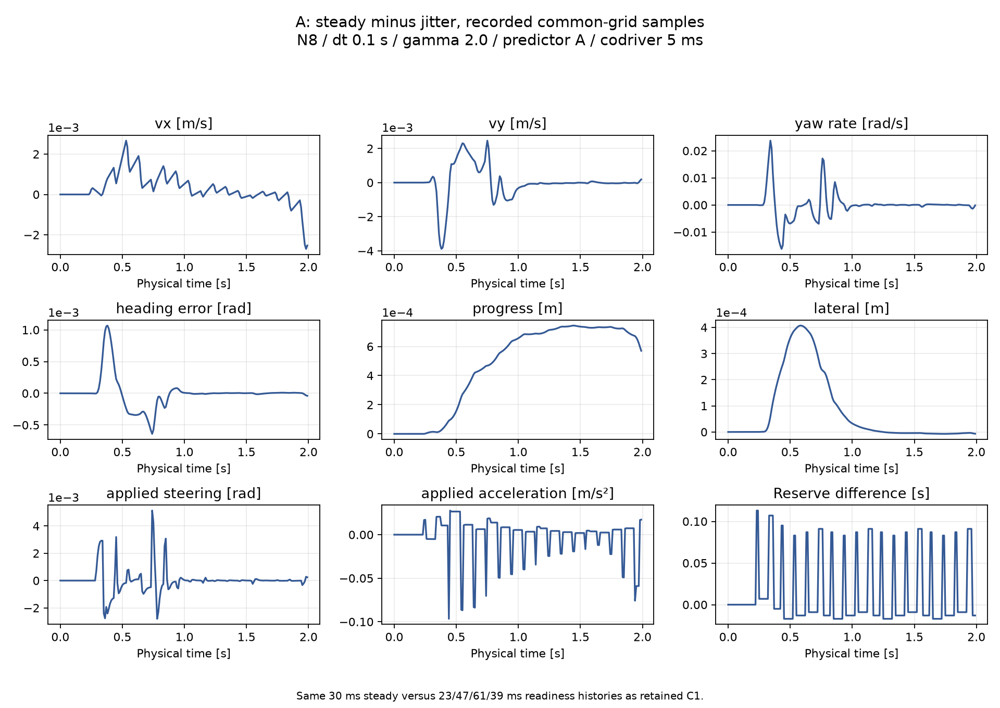
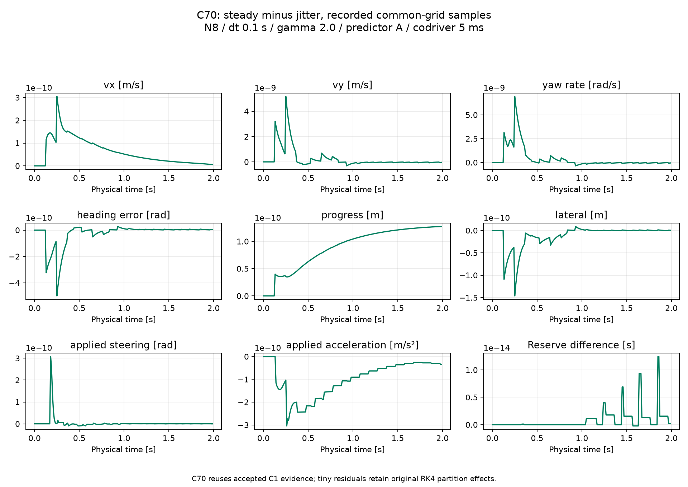
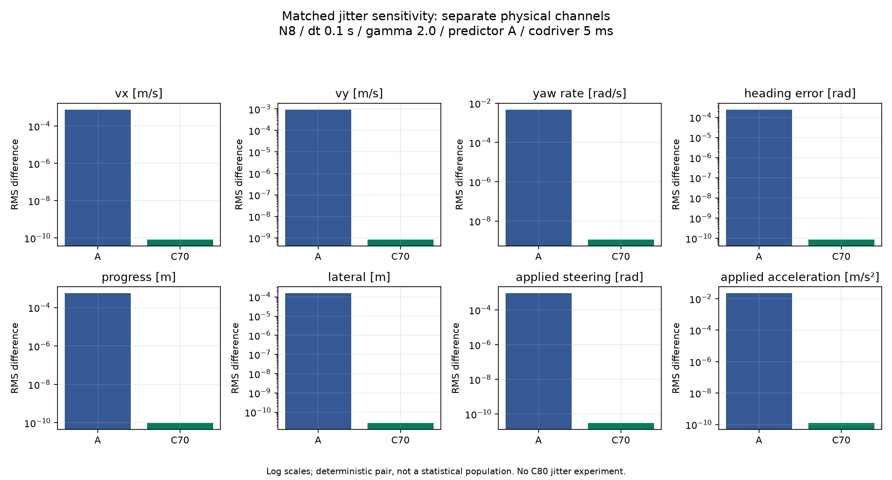
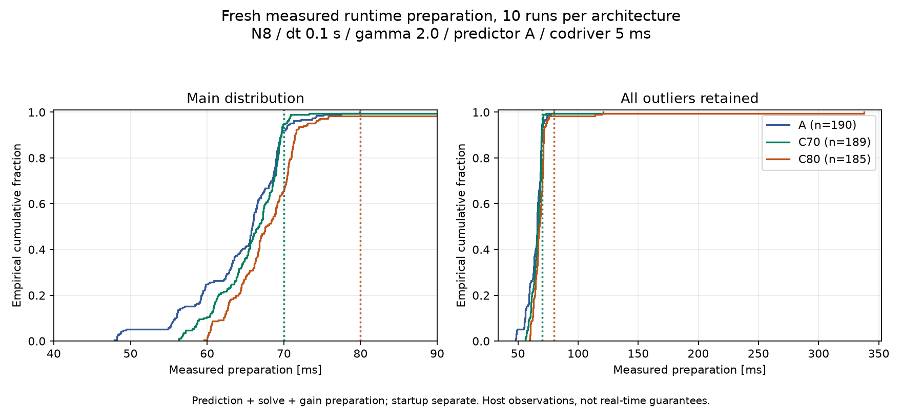
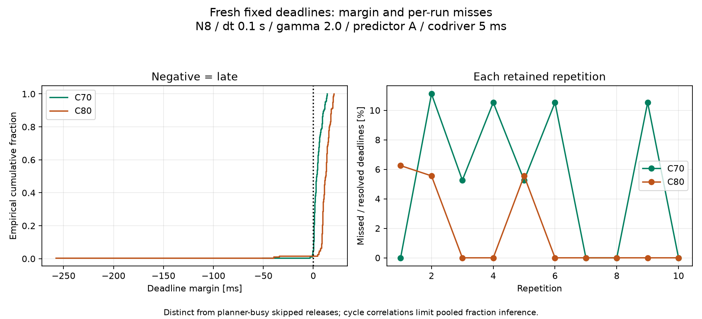
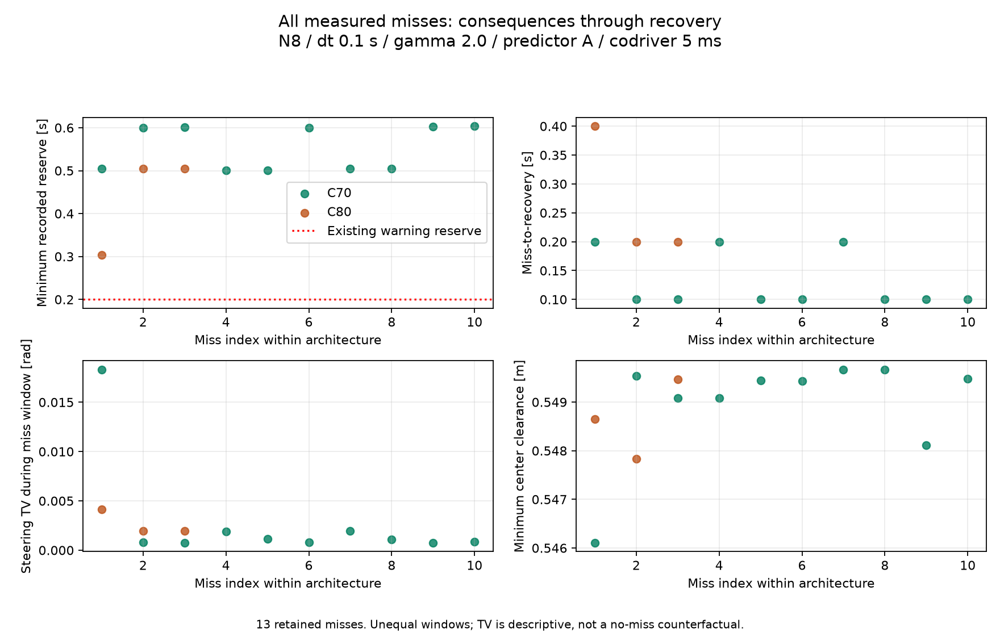
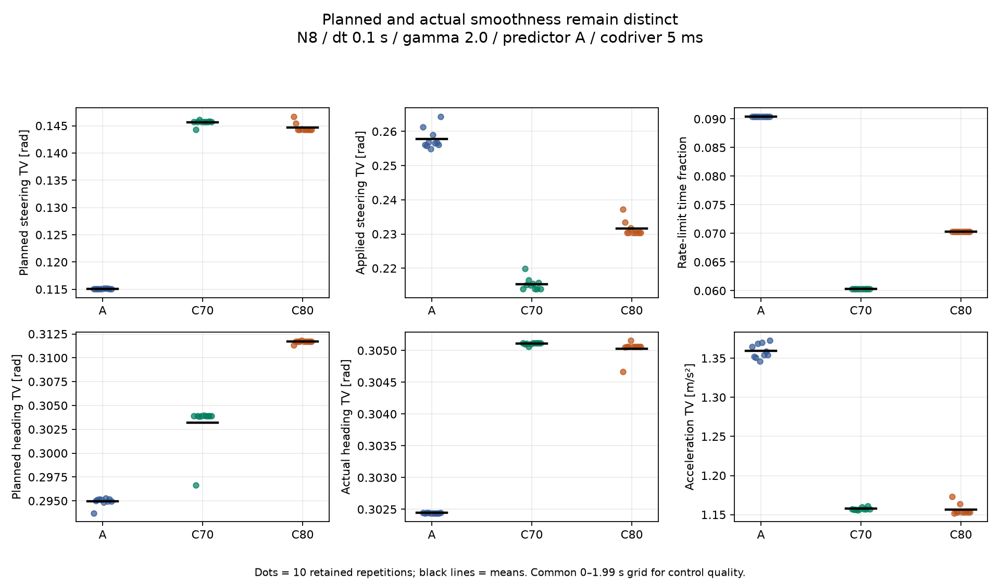
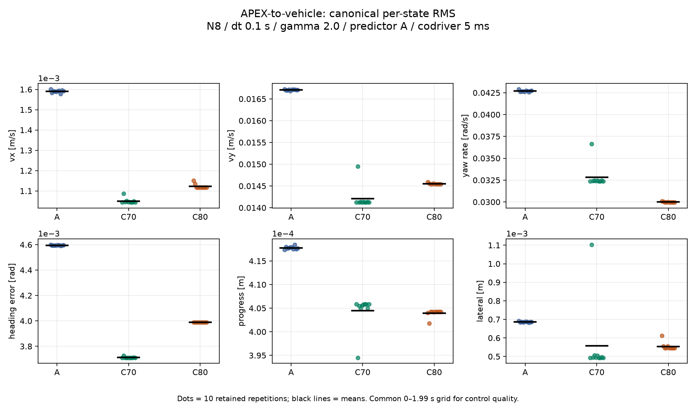
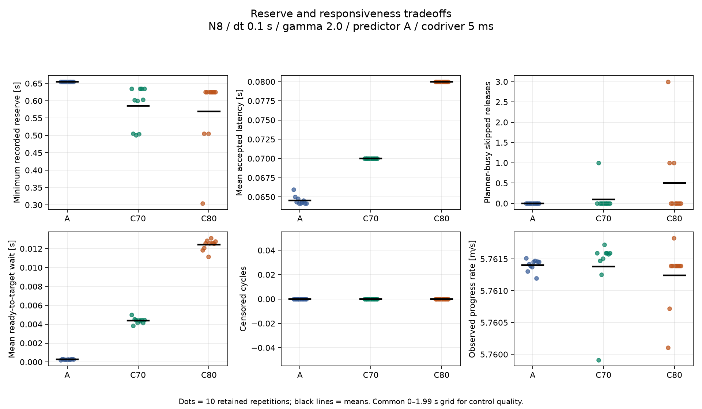
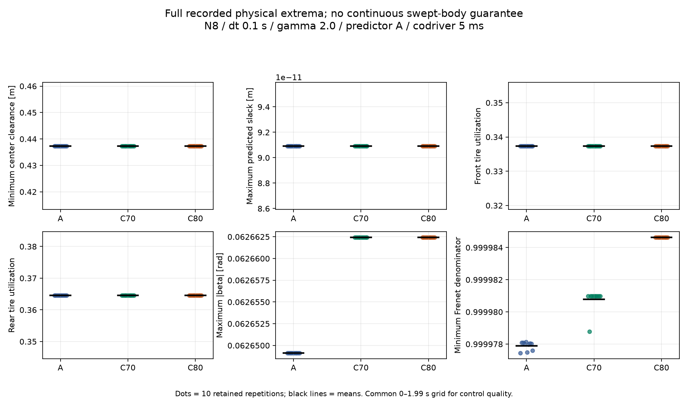

# Task007D-CX — Architecture C closure, Studies 1–2 WORK results

## 1. Task Completed

**WORK_COMPLETE_PENDING_REVIEW.** Two fresh matched-jitter variable-A runs and ten fresh measured
repetitions each of A, C70 and C80 completed. Reused fixed C70 jitter evidence passed the source,
fixture and exact causal replay audit. All runs requested 2 s of synthetic physical time. No run
was replaced; all timing outliers and missed deadlines are retained. No scientific stop gate fired.
This is WORK completion, not formal verification or scientific acceptance.

Scope follows the [unchanged Primary specification](TASK007D_CX_SPEC.txt) and the later authorization
restricting work to Studies 1–2. The [predeclared protocol](TASK007D_CX_CLOSURE.md) was hashed before
new outcomes. Study 3, full laps, final architecture selection, Performance freeze and Efficiency
are **NOT EXECUTED — AWAITING ENGINEERING REVIEW**.

## 2. Exact Source Revision

Base/current experimental core: `77ba86f28e24d2780d01b5b0058e5405dde3d6ec`, main.
Only new CX tooling/tests/documentation were added; existing runtime, models, scheduler, predictor,
solver settings, fixture files and historical scripts remain byte-identical. Per-worker source,
fixture, vehicle, environment and raw hashes are in [provenance.json](task007d/cx/tables/provenance.json).
Final WORK file/log hashes and preservation counts are in [verification.json](task007d/cx/verification.json).
The delivery commit contains this report; its exact SHA/URL is supplied in the GitHub handoff.

The supplied file had a duplicate `.txt.txt` extension and was normalized to the requested name
without changing bytes. Specification SHA256:
`b741f45e38555b3b8f330d40abde9765541ff267995bad9f643cfbbb0345a0c7`.
Retained C1 had 85/87 source hashes identical; the two differences were the already accepted
urgent-bookkeeping changes in asynchronous.py/fixed_handoff.py. Neither retained history triggered
urgent demand. Current-source recorded-packet replay reproduced states, controls (excluding host
wall telemetry), reserves, fixed cycles, handoffs and RK4 segments exactly, checking 20 causal
preparation inputs per history. Unchanged predictor/NMPC plus exact release context justify reuse;
this is not a claim that the whole historical source revision matched. See [reuse audit](task007d/cx/reuse_audit.json).

## 3. Architecture A Reference

Variable-availability handoff and legacy predictor A remain the production defaults. The same
frozen Task007C synthetic candidate is used throughout: N=8, dt=0.1 s, H=0.8 s,
Q=diag(4,4,1,200,200), R=diag(25,1), W=diag(1,0.1), lambda_s=0, alpha_vy=alpha_r=1,
gamma=2.0; unchanged terminal construction, constraints, TVLQR at 100 Hz, nonlinear tires/plant,
RK4, IPOPT, warm starts and 0.08 m synthetic tracking margin. Initial progress is 1 m and the
initial state is exactly the accepted C1 Planning sample. Study 2 has ten new A references with
identical requested duration, fixture, codriver delay, isolation and rotating run order.

## 4. Architecture C70 Reference

Existing opt-in `fixed_handoff_offset=0.07`; predictor A forecasts to release+70 ms.
Packet nominal start/authority follow that fixed target. No new scheduler implementation.
Late work remains busy until completion and can never activate after its missed commitment.
The old valid packet and pending actuator commands continue under unchanged rules.

## 5. Architecture C80 Reference

Same configuration except `fixed_handoff_offset=0.08`. Both fixed candidates change forecast
duration as well as handoff scheduling relative to variable A. Results cannot isolate scheduling
alone from target-dependent optimization or preparation cost. B remains experimental and unused;
P0/P1a/P1b remain unselected. C is an opt-in research mode, not a promoted default.

## 6. Matched Jitter Histories

Study 1 compares constant 30 ms against cyclic 23/47/61/39 ms preparation readiness; both use
5 ms imposed codriver latency. All ready events are before the 70 ms fixed deadline. The sequences
are the exact retained C1 histories, stored in [protocol.json](task007d/cx/protocol.json). Two new A
runs are compared with the two audited retained C70 runs. C80 jitter was not rerun without need.
All releases match within each pair; fixed accepted packet IDs/times match; variable acceptance
changes. Full causal inputs, packet contents, references, reserve and event comparisons are in
[summary.json](task007d/cx/tables/summary.json), with cycle/control/residual/partition CSV files.

## 7. Variable-A Jitter Sensitivity

The common 10 ms grid has 200 samples at 0–1.99 s. Canonical ordering is
[vx, vy, r, epsi, s_abs, ey]; heading residuals wrap. Control rows are preceding applied commands.
Units are m/s, m/s, rad/s, rad, m, m, rad, m/s². Values below are steady-minus-jitter differences,
not tracking errors and not prediction-error scores.

| Channel (SI) | A RMS | A max abs | C70 RMS | C70 max abs |
|---|---|---|---|---|
| vx | 0.000769641979 | 0.00270009961 | 8.35680058e-11 | 3.04432923e-10 |
| vy | 0.000937834636 | 0.00388709513 | 8.45184103e-10 | 5.17141283e-09 |
| r | 0.00475054025 | 0.0237557908 | 1.15554124e-09 | 6.93191754e-09 |
| e_psi | 0.000243759194 | 0.00106783472 | 8.76762401e-11 | 5.00040898e-10 |
| s_abs | 0.000556569406 | 0.000743277837 | 9.6761727e-11 | 1.27235111e-10 |
| e_y | 0.000154876182 | 0.000407185159 | 2.68687506e-11 | 1.4610347e-10 |
| delta | 0.000921190984 | 0.00512822135 | 3.02997797e-11 | 3.07739882e-10 |
| a_cmd | 0.0221737555 | 0.0966516353 | 1.24005027e-10 | 3.04432923e-10 |

Variable A first exceeds predeclared descriptive thresholds at 0.24 s for acceleration, 0.29 s
for steering, 0.30 s for yaw rate, 0.32 s for heading, 0.35 s for lateral velocity and 0.40 s for
longitudinal velocity. Progress/lateral-position differences stay below their 1 mm thresholds.
These are reporting thresholds, not safety tolerances. First sampled reference difference is
0.23 s. At the second runtime release (0.2 s), predicted initial states, packet states/controls,
gains, curvature samples and nominal timestamps diverge as measured history changes the estimator.

## 8. Fixed-C Jitter Sensitivity

C70 has no crossing of any predeclared descriptive threshold. Maximum common-grid state residual
is 6.932e-9 rad/s in yaw rate; the largest RMS is 1.156e-9 rad/s. Accepted authority times and
nominal packet times are identical. Tiny plan/reference/control differences propagate from the
plant's different integration partitions; C70 is not bitwise identical.

Both A and C first differ numerically at recorded physical time 0.125 s (first common grid 0.13 s).
The 0.123 s readiness splits the same held-command interval 0.120–0.125 s into 3+2 ms instead of
5 ms. The retained [partition check](task007d/c/amended/partition_check.json) and exact current
replay support this mechanism; integration was not changed. C70's next packet differences are
approximately 1e-9; nominal timestamps never diverge. Its first reference difference is 0.27 s.

## 9. Direct Jitter Sensitivity Comparison

**Fixed C70 materially reduces sensitivity in these matched sub-deadline histories.** The residual
is numerical-scale; variable A develops much larger feedback/optimization differences. This
finding is limited to this short history and jointly reflects fixed targets and fixed authority.
It is not evidence of bitwise reproducibility or superiority in all sectors.

| History | RK4 segments | min/max dt, ms | Non-grid readiness events | Ready boundaries | Handoff boundaries | Application boundaries | Readiness-only boundaries |
|---|---:|---|---:|---:|---:|---:|---:|
| A steady | 400 | 5 / 5 | 0 | 19 | 19 | 200 | 0 |
| A jitter | 427 | 1 / 5 | 19 | 19 | 19 | 200 | 8 |
| C70 steady | 400 | 5 / 5 | 0 | 19 | 19 | 200 | 0 |
| C70 jitter | 419 | 1 / 5 | 19 | 19 | 19 | 200 | 19 |

Event categories can overlap; counts must not be added. Event timestamp CSVs retain the original
segmentation. Common-grid comparisons still show the disparity, so it is not merely sampling
one architecture at more off-grid instants. No integrator modification was used to hide differences.

## 10. C70 Fresh Measured Timing

Ten sequential fresh SINGLE runs, 189 runtime preparations. Preparation mean/median/p95/p99/max
are 65.931/66.751/70.034/71.161/120.735 ms. Ten actual misses; max two consecutive. One nominal
release was skipped while a computation remained busy. No solver overlap or cancellation.

## 11. C80 Fresh Measured Timing

Ten sequential fresh SINGLE runs, 185 preparations. Mean/median/p95/p99/max are
69.368/67.681/73.084/115.149/337.787 ms. Three actual misses; max one consecutive. Five nominal
planner releases were skipped while busy. The 337.787 ms outlier is retained, not replaced.

All runtime preparation distributions, milliseconds:

| Architecture | n | Mean | Median | P95 | P99 | Maximum | Minimum |
|---|---|---|---|---|---|---|---|
| A | 190 | 64.285820 | 65.862041 | 70.734592 | 75.444858 | 79.934458 | 47.908083 |
| C70 | 189 | 65.931304 | 66.751042 | 70.033850 | 71.161383 | 120.735459 | 56.295625 |
| C80 | 185 | 69.368145 | 67.681500 | 73.084325 | 115.149021 | 337.787083 | 59.574125 |

P99 is an empirical quantile of 185–190 correlated cycle samples, not a reliable tail guarantee.
Per-run distributions and ranges are retained separately; ten repetitions are not 190 independent
experiments. Startup preparation is excluded from runtime deadline denominators and retained in
per_run.csv (mean A/C70/C80: 46.882/46.689/45.770 ms).

## 12. Deadline Hit/Miss Results

| Architecture | Repetitions | Releases/resolved | Ready on time / accepted | Misses | Miss fraction | Descriptive Wilson 95% interval | Max consecutive | Busy release skips |
|---|---:|---:|---:|---:|---:|---|---:|---:|
| A | 10 | 190 | N/A / 190 | N/A | N/A | N/A | N/A | 0 |
| C70 | 10 | 189 | 179 / 179 | 10 | 5.2910% | 2.8990–9.4642% | 2 | 1 |
| C80 | 10 | 185 | 182 / 182 | 3 | 1.6216% | 0.5530–4.6585% | 1 | 5 |

No rejected handoff, censored runtime completion/target or codriver busy tick occurred. A has no
fixed deadline; N/A must not be interpreted as a zero fixed-miss risk. Wilson intervals overlap
and ignore within-run correlation, so they are descriptive only. Fresh target-specific timing,
not historical ECDF estimates, determines these counts.

Deadline margins, milliseconds (fixed target minus physical ready time):

| Architecture | n | Mean | Median | P95 | P99 | Maximum | Minimum |
|---|---|---|---|---|---|---|---|
| A | 0 | N/A | N/A | N/A | N/A | N/A | N/A |
| C70 | 189 | 4.068696 | 3.248958 | 11.830650 | 13.452694 | 13.704375 | -50.735459 |
| C80 | 185 | 10.631855 | 12.318500 | 19.555584 | 20.026413 | 20.425875 | -257.787083 |

## 13. Deadline Miss Consequences

| Case / plan | Miss deadline s | Late discard s | Next acceptance s | Minimum recorded reserve in window s | Classification |
|---|---|---|---|---|---|
| S2_C70_02 / 5 | 0.570 | 0.620735459 | 0.770 | 0.505000 | Recovered; no validity/reserve violation |
| S2_C70_02 / 12 | 1.370 | 1.370505625 | 1.470 | 0.600496 | Recovered; no validity/reserve violation |
| S2_C70_03 / 12 | 1.270 | 1.270845916 | 1.370 | 0.601503 | Recovered; no validity/reserve violation |
| S2_C70_04 / 12 | 1.270 | 1.270404917 | 1.470 | 0.500610 | Recovered; no validity/reserve violation |
| S2_C70_04 / 13 | 1.370 | 1.370872208 | 1.470 | 0.500610 | Recovered; no validity/reserve violation |
| S2_C70_05 / 13 | 1.370 | 1.370134500 | 1.470 | 0.600253 | Recovered; no validity/reserve violation |
| S2_C70_06 / 16 | 1.670 | 1.670675875 | 1.870 | 0.504105 | Recovered; no validity/reserve violation |
| S2_C70_06 / 17 | 1.770 | 1.770606042 | 1.870 | 0.504105 | Recovered; no validity/reserve violation |
| S2_C70_09 / 10 | 1.070 | 1.070800625 | 1.170 | 0.602638 | Recovered; no validity/reserve violation |
| S2_C70_09 / 18 | 1.870 | 1.873282000 | 1.970 | 0.603639 | Recovered; no validity/reserve violation |
| S2_C80_01 / 11 | 1.180 | 1.437787083 | 1.580 | 0.304264 | Recovered; no validity/reserve violation |
| S2_C80_02 / 9 | 0.980 | 1.014257834 | 1.180 | 0.505000 | Recovered; no validity/reserve violation |
| S2_C80_05 / 17 | 1.780 | 1.819827750 | 1.980 | 0.505000 | Recovered; no validity/reserve violation |

All misses occurred in the initial `long_straight` sector. The [miss table](task007d/cx/tables/miss_consequences.csv)
retains each speed, progress, curvature, front/rear utilization, beta, old packet ID/age, reserve,
six-state tracking error, steering variation, clearance, release-window slack and recovery timestamp.
No observed miss was physically invalid or crossed the existing 0.2 s reserve-warning threshold.
All recovered without fallback; this narrow classification does not assert that every miss was
performance-neutral. There is no counterfactual measured rerun for individual events.

The C70_02 plan-5 miss at 0.570 s completed/discarded at 0.620735459 s; next authority arrived
0.770 s. Its 120.735 ms wall preparation used 82.470 ms CPU (15 solver iterations). This run has
0.0011034 m lateral RMS and 0.00499644 m peak, worse than A's mean RMS and worst peak. It is a
performance-degrading association, not a proven isolated causal effect.

The C80_01 plan-11 miss at 1.180 s completed/discarded at 1.437787083 s and recovered at 1.580 s.
It held old authority for 0.5 s, with 0.4 s from missed deadline to recovery and three skipped
nominal launches. Preparation used 115.083 ms CPU versus 337.787 ms wall (17 iterations). The
wall/CPU gap indicates elapsed time beyond CPU consumption; it does not establish a host-process
root cause. No adverse sample was excluded.

## 14. Trajectory Reserve

Minimum recorded reserve: A 0.655 s, C70 0.500609542 s, C80 0.304263667 s. Derived old-packet
reserve immediately before recovery can be lower than the last recorded sample: worst 0.5 s
C70 and 0.3 s C80. The distinction is explicit in miss_consequences.csv. Both remain above the
existing warning 0.2 s and critical 0.05 s; no exhaustion or fallback occurred. Long tails lower
reserve even when aggregate miss fraction improves. Packet age, expiry, reserve at acceptance,
actual accepted latency and first TVLQR use are preserved per cycle; missed/nonapplicable
acceptances remain null. Fixed accepted packet age is 70/80 ms from generation; nominal trajectory
age at its scheduled activation is zero. TVLQR remains active while waiting and during misses.

## 15. Track Clearance / Slack

Minimum recorded center clearance is 0.437313818 m in all three architectures, limited by the
shared initial condition; no clearance improvement is established. Max predicted slack is
9.091525285e-11 m, below the unchanged 1e-6 m pilot gate. No boundary crossing. The 0.08 m
synthetic tracking margin is retained. These are sampled center-clearance results, not continuous
swept-body or real-world safety certification.

## 16. Tire Utilization / Sideslip

| Metric (mean per run unless marked) | A | C70 | C80 |
|---|---|---|---|
| max front utilization | 0.337348551 | 0.337348551 | 0.337348551 |
| max rear utilization | 0.364600869 | 0.364600869 | 0.364600869 |
| max |beta|, rad | 0.0626491282 | 0.0626624135 | 0.0626624135 |
| minimum Frenet denominator | 0.999977441 | 0.999978772 | 0.999984623 |
| max steering utilization | 0.14993126 | 0.140756517 | 0.140756517 |

Whole-event extrema include off-grid samples. Tires, Frenet validity and actuator bounds were
unchanged. The tested initial straight does not exercise the full high-demand fixture.

## 17. Steering / Rate Smoothness

| Metric (mean per run unless marked) | A | C70 | C80 |
|---|---|---|---|
| planned steering TV, rad | 0.115107973 | 0.145643834 | 0.144638519 |
| applied steering TV, rad | 0.257784575 | 0.21538216 | 0.23156313 |
| rate reversal count | 22.6 | 22.9 | 22 |
| max reversal magnitude, rad/s | 2 | 1.64129264 | 2 |
| rate-limit application-interval occupancy | 0.0904522613 | 0.0603015075 | 0.0703517588 |
| rate-limit application-interval time, s | 0.18 | 0.12 | 0.14 |
| acceleration TV, m/s² | 1.35912536 | 1.15749602 | 1.15619311 |

Mean applied steering TV falls 16.45% with C70 and 10.17% with C80. Per-run ranges:
A 0.254958–0.264409 rad, C70 0.213948–0.219965, C80 0.230463–0.237201.
Planned steering TV increases. Rate-limit occupancy is derived from command increments divided
by elapsed application intervals, not an independently measured continuous actuator motion.
The physical rate bound remains 1 rad/s; no smoothing or clipping policy was changed.

## 18. Heading Smoothness

| Metric (mean per run unless marked) | A | C70 | C80 |
|---|---|---|---|
| planned world-heading TV, rad | 0.294933799 | 0.30319274 | 0.311703044 |
| actual world-heading TV, rad | 0.302441852 | 0.305109077 | 0.305026935 |

Actual heading TV rises approximately 0.88% (C70) and 0.85% (C80), despite better heading RMS.
Planned heading variation also rises. No single smoothness score conceals this regression.

## 19. APEX→Vehicle Tracking

| Canonical state (SI) | A mean RMS | C70 mean RMS | C80 mean RMS | A worst peak | C70 worst peak | C80 worst peak |
|---|---|---|---|---|---|---|
| vx | 0.00159067656 | 0.00105016793 | 0.00112296629 | 0.00765362273 | 0.00648161832 | 0.00667935435 |
| vy | 0.0167077565 | 0.0142103289 | 0.0145529957 | 0.0732607966 | 0.0705246363 | 0.0714421404 |
| r | 0.0426956447 | 0.0328348802 | 0.0299851845 | 0.311389148 | 0.143090256 | 0.114706733 |
| e_psi | 0.00459560178 | 0.00371236777 | 0.00398972735 | 0.0216704484 | 0.0235309565 | 0.024228155 |
| s_abs | 0.000417784371 | 0.000404454546 | 0.000403942459 | 0.00114194806 | 0.00109510211 | 0.00108867451 |
| e_y | 0.000686313319 | 0.000557801647 | 0.000554328213 | 0.00385814585 | 0.00499644251 | 0.00278112277 |

Each mean is the mean of ten per-run RMS values; worst peak is the largest recorded per-run
absolute error. All use the same 200 physical grid samples and active accepted packet, with
wrapped heading. All six mean RMS values improve for both fixed candidates. Peak heading error
worsens for both; C70's worst lateral peak also worsens. See per_run.csv for run ranges and
summary.json for distribution statistics. No tail is removed from these comparisons.

## 20. Planning→APEX Adaptation

| Metric (mean per run unless marked) | A | C70 | C80 |
|---|---|---|---|
| Planning→APEX vx RMS, m/s | 0.17554785 | 0.175377898 | 0.175555772 |
| Planning→APEX heading RMS, rad | 0.0122151507 | 0.0137338482 | 0.0138396997 |
| Planning→APEX lateral RMS, m | 0.00890535822 | 0.0083634804 | 0.00825802026 |
| Planning→vehicle speed RMS, m/s | 0.175381262 | 0.175153053 | 0.175340243 |

Planning owns the same frozen offline line and speed profile. These differences compare each
active APEX reference with Planning at its nominal progress, and are distinct from APEX→vehicle
tracking. No reference generation or controller cost changed.

## 21. Responsiveness

Mean actual release-to-accepted-authority latency: A 64.560 ms, C70 70 ms, C80 80 ms.
Those accepted-only numbers exclude missed releases: worst old-authority intervals are 0.3 s
C70 and 0.5 s C80. Mean wait after readiness, including zero-wait late work: A 0.274 ms,
C70 4.380 ms, C80 12.426 ms. cycles.csv preserves every individual wait and missed commitment.
At 1.5/3/6 m/s, ideal fixed-offset travel is 0.105/0.210/0.420 m for C70 and
0.120/0.240/0.480 m for C80. These are constant-speed calculations, not extra simulated runs.
TVLQR continues during waiting, so high-level responsiveness and low-level feedback are distinct.
No new urgent demand arose in this short campaign; accepted C0 urgent semantics remain unchanged.

## 22. Computational Timing

Runtime readiness is each measured complete preparation duration (prediction + optimization +
gain preparation and existing overhead), with no imposed planner replay in Study 2. Prediction
receives only its release-known estimated/fixed target. Physical codriver delay remains imposed
at 5 ms for all architectures; measured codriver costs are descriptive. All 602 runtime causal
release forecasts across the 32 fresh runs exactly match NMPC state/previous-input initialization.

Workers are fresh, sequential, native Accelerate SINGLE before numerical initialization;
observed process thread counts before/after every preparation are [1]. Whole-worker CPU/wall
ratios span 0.9234–0.9999. No tests, rendering or analysis overlapped measured workers. Guards and
1 GiB disk floor passed. The user closed macOS Storage scanning before measurements; process
inventory was retained. Ordinary OS/browser activity is not eliminated and host tails remain.
Environment: macOS 26.5.1 arm64, NumPy 2.5.3, SciPy 1.18.1, CasADi 3.8.1, psutil 7.2.2,
threadpoolctl 3.7.0. These Mac timings are neither embedded nor hard-real-time certification.

## 23. Physical Validity

All 32 new runs clear declared boundary/slack/model/solver/chronology/reserve/fallback gates;
no early or late invalid packet authority. No target reconstruction is needed for Study 1's
recorded common-event comparison. Every measured run covers the requested 2 s; common quality
ends at 1.99 s, while physical extrema use all recorded event samples. No truncated run is compared
as a full-duration success. Coverage is only the initial straight, progress roughly 1–12.5 m;
the hairpin beginning near 21.024 m is not visited.

## 24. Architecture Selection Table

| Metric | A | C70 | C80 |
|---|---:|---:|---:|
| minimum reserve | 0.655 | 0.5006095419 | 0.3042636668 |
| minimum center clearance | 0.4373138184 | 0.4373138184 | 0.4373138184 |
| maximum slack | 9.091525285e-11 | 9.091525285e-11 | 9.091525285e-11 |
| maximum abs beta | 0.06264912825 | 0.06266241348 | 0.06266241345 |
| mean applied steering TV | 0.2577845752 | 0.2153821596 | 0.23156313 |
| mean actual heading TV | 0.3024418519 | 0.3051090768 | 0.3050269348 |
| mean steering-rate limit occupancy | 0.09045226131 | 0.06030150754 | 0.07035175879 |
| mean lateral tracking RMS | 0.0006863133194 | 0.0005578016471 | 0.0005543282125 |
| mean heading tracking RMS | 0.004595601779 | 0.003712367771 | 0.003989727354 |
| mean progress rate | 5.761402895 | 5.761381938 | 5.761240481 |
| p95 preparation seconds | 0.07073459204 | 0.07003385006 | 0.07308432492 |
| p99 preparation seconds | 0.07544485755 | 0.07116138312 | 0.1151490205 |
| mean accepted authority latency seconds | 0.06456019572 | 0.07 | 0.08 |
| deadline miss fraction | N/A | 0.05291005291 | 0.01621621622 |
| physical validity / chronology | All observed gates pass | All observed gates pass | All observed gates pass |
| matched jitter heading RMS difference, rad | 0.0002437591941 | 8.767624006e-11 (reused C1) | Not evaluated in Study 1 |
| full-lap performance | NOT EXECUTED | NOT EXECUTED | NOT EXECUTED |

The table follows the declared priority order conceptually: validity and chronology first,
then deadlines/reserve, jitter, quality, responsiveness, progress and cost. No scalar ranking.
C80's lower observed miss fraction trades against its largest tail, lowest reserve and slower
accepted response. C70's steering/heading RMS advantage trades against more misses and a worse
lateral outlier. Common-grid progress gains average 11.465192/11.465150/11.464869 m for A/C70/C80;
sub-millimetric differences do not establish racing performance. No lap was completed.

## 25. Study 3 Trigger Decision

**NOT EXECUTED — AWAITING ENGINEERING REVIEW.** Study 1 strongly supports fixed-target jitter
robustness. Study 2 supports further interest, but the strict unique-candidate/meaningfully-better-
overall trigger is not decisively met: miss-fraction uncertainty overlaps, peak/TV tradeoffs remain,
and all coverage is straight. Recommend review of C70 as the control-quality/responsiveness
candidate and C80 as the deadline-reliability challenger. Engineering must resolve these tradeoffs
and select at most one candidate before separately authorizing Study 3. No automatic full lap.

## 26. Long-Lap Confirmation Results

**NOT EXECUTED — AWAITING ENGINEERING REVIEW.** No full-lap conclusion is available.

## 27. Per-Lap Results

**NOT EXECUTED — AWAITING ENGINEERING REVIEW.** Initial partial progress is not a lap.

## 28. Remaining Architecture C Limitations

Fixed authority reduces sub-deadline sensitivity but does not remove RK4 partition dependence,
forecast mismatch, timing tails, stale old-packet authority during misses or reaction delay.
The observed tails reduce reserve even without current failures. No matched C80 jitter rerun,
urgent-demand campaign, high-curvature measured coverage or hardware certification is claimed.

## 29. Recommended Timing Architecture

**D. INSUFFICIENT EVIDENCE — DO NOT FREEZE TIMING ARCHITECTURE.** Keep A as the operational
reference and both C candidates experimental pending review. This does not reject C; it separates
a strong short jitter result from unresolved overall reliability/quality/response tradeoffs.
No production default or final architecture selection was changed.

## 30. Proposed APEX Performance Manifest

No freeze candidate is selected, so a final Performance manifest is not issued. The exact
**synthetic APEX Performance candidate** used for research is preserved in protocol.json plus
each worker's configuration/simulation/provenance: frozen N8/dt0.1/H0.8, full existing control
parameterization, Q/R/W above, lambda0, original terminal policy, A predictor, fixed TVLQR,
existing solver/warm start, SINGLE, constraints and reserve/fallback. Only A/C70/C80 scheduling
and their associated forecast targets differ. A future manifest requires a reviewed architecture.

## 31. Is APEX Performance Ready to Freeze?

No. Formal verification and Primary/Engineering acceptance remain outstanding; Study 3 is
unauthorized in this WORK assignment. No physically validated claim is made.

## 32. Future APEX Efficiency Candidates

Documented only; none implemented: reduced control horizon with Np=8; move blocking
[1,1,1,1,2,2], [1,1,2,2,2], [1,1,2,4]; bounded-suboptimal/early-stopped IPOPT;
iteration caps/real-time budgets; tolerance studies; warm-start improvements; JIT/compiled
CasADi/code generation; prediction/gain-preparation optimization; sampling-time/plant-bandwidth
studies; alternative discretization; reduced/local explicit MPC feasibility; hardware-dependent
Performance-versus-Efficiency evaluation. No System Identification, LMPC, adaptive codriver,
energy or opponent-control work has begun.

## 33. Required Figures

All ten applicable figures were generated reproducibly from compact saved tables after measurements
and visually inspected for units, legends and legibility. Full-lap figures 11/12 are NOT EXECUTED.

**1. matched_jitter_A.** Variable A changes authority timing and the rolling forecast target; physical and requested-control differences grow beyond the predeclared descriptive thresholds.

**2. matched_jitter_C.** Reused C70 has identical accepted authority timestamps but tiny numerical differences. The independently matched current-source replay is in reuse_audit.json.

**3. jitter_sensitivity_comparison.** Common-grid six-state and control residuals remain separate. Fixed residuals are many orders smaller; the log scale does not imply zero difference.

**4. measured_deadline_distribution.** Fresh runtime preparation ECDFs retain all outliers, including the 337.8 ms C80 tail. Dashed deadlines apply only to the fixed candidates.

**5. c70_vs_c80_deadline_margin.** Negative measured margins are actual misses. Mean accepted latency excludes missed launches; margin includes every completed runtime preparation.

**6. deadline_miss_consequences.** All 13 misses and recoveries remain visible, including reserve, physical clearance and steering variation through recovery.

**7. smoothness_comparison.** Applied steering improves on average, while actual and planned heading variation rise. Planned and applied controls are separate.

**8. tracking_comparison.** Six-state RMS and peak tracking results use the same recorded 0–1.99 s coverage. Mean RMS improvements coexist with worse peak heading and one C70 lateral outlier.

**9. reserve_comparison.** Reserve loss and planner-busy skips expose the cost of late work. C80's largest delay leaves less reserve despite its lower miss fraction.

**10. physical_validity.** Recorded extrema pass the synthetic gates. The common initial condition limits minimum clearance; this is not swept-body safety certification.

## 34. Regression / Verification Status

Before either dependent experiment: **225 focused tests passed in 27.66 s**, covering frozen
configuration, mathematical/model validity, chronology, fixed/variable compatibility, diagnostic
noninterference and native threading. Scoped Ruff passed. Exact command/files and logs are in the
[reproduction guide](TASK007D_CX_REPRODUCTION.md) and verification.json.

After analysis refinements: **13 CX tests passed in 0.83 s**; scoped Ruff check/format pass on eight
new Python files. An intermediate portable isolated test failed because StraightPlanner omits a
diagnostic field; its test setup now supplies the fixture's explicit target. The original failure
log (11 passed, 1 failed) is retained. No runtime/controller fix or scientific rerun followed.
No mathematical tolerance was relaxed. The current tests need no ignored historical raw data.

**Deferred to explicitly authorized VERIFICATION:** complete tests/ regression and acceptance
checks on the exact reviewed delivery revision, broader integration and final evidence audit.
The prior C 696-pass result remains historical, not a fresh CX claim. No full suite was run merely
to close WORK. File hashes and historical raw metadata were audited for this delivery.

## 35. Generated Artifacts

New tooling: scripts/run_task007dcx.py and scripts/task007dcx/{worker,reuse,analysis,report,figures}.py
plus package initializer; tests/unit/test_cx_closure.py. New specification/protocol/results/reproduction
and compact evidence under docs/task007d/cx/. Updated handoff, ADR-161 and roadmap only.
Raw run data, release contexts, original RK4 segments, launch/test/process logs and initial analysis
remain ignored under results/task007d/cx/; prior research directories are untouched.

Committed compact evidence: protocol/reuse audit/WORK verification; per-run and per-cycle tables;
every miss; per-state jitter/control/reference residuals; original segment timestamps; source/fixture
provenance; ten figures. [summary.json](task007d/cx/tables/summary.json) retains per-state distributions
and all per-run uncertainty; [selection inputs](task007d/cx/tables/architecture_selection.md) are not
a production decision. Raw experiment archives are not committed.

## 36. Known Limitations

Ten repetitions per candidate, one Mac session and correlated cycles provide limited tail confidence.
All short runs begin from the same initial straight, so startup behavior contributes heavily.
The codriver uses matched imposed delay, not measured actuation. No independent physical validation,
full lap, swept-body check or real hardware evidence. Matched jitter changes readiness histories;
A's estimator and fixed targets also change optimization, so scheduling-only attribution is invalid.
Miss consequences are observational without individual counterfactual replays. All unfavorable
outliers are included. Compact outputs reproduce analysis/figures; rerunning raw measurements
will change host times and resulting trajectories. Raw retained C1 files are needed for its exact
compatibility replay and are intentionally not included in the small Git deliverable.

## 37. Architecture Deviations

None. No existing executable/runtime file, defaults, controller mathematics, physical model,
actuator limit, estimator, RK4 or scheduler was changed. New recording is outside preparation timing;
existing release observation/RecordedPlant instrumentation is reused and focused parity tested.
User-authorized WORK scope narrows the Primary specification to Studies 1–2 and defers full formal
verification. This is an explicit stage boundary, not an unreported experimental omission.

## 38. Recommended Next Step

Engineering Review of this exact commit, the tail/miss evidence and the proposed no-freeze assessment.
Then authorize formal VERIFICATION and decide whether a single candidate warrants a separately
bounded Study 3. No further experiment, B comparison, Efficiency work or promotion starts here.

## 39. Reproduction Commands

See [TASK007D_CX_REPRODUCTION.md](TASK007D_CX_REPRODUCTION.md) for exact prerequisites, fresh-directory
replay/run commands, sequential order, analysis and figures. Reproduction instructions are not
authorization to repeat an accepted campaign. Preserve current raw and compact directories.
