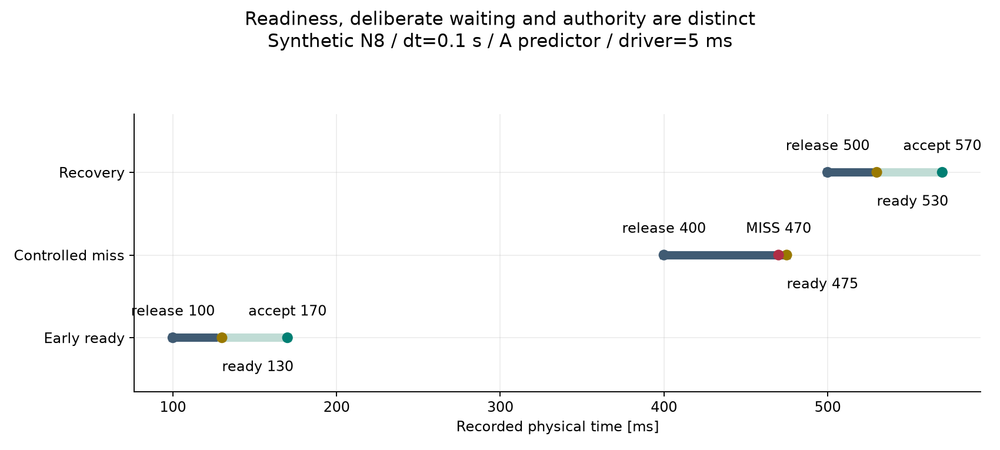
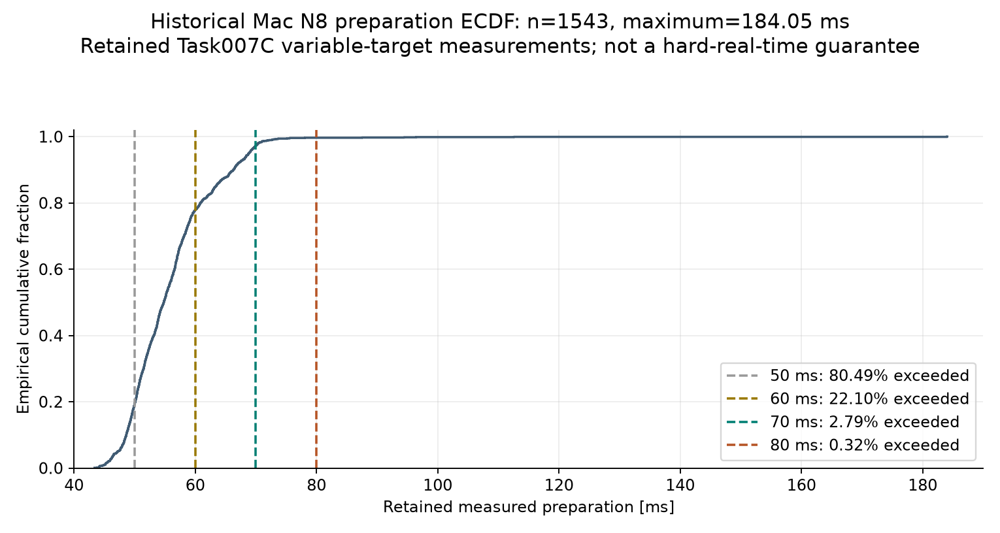
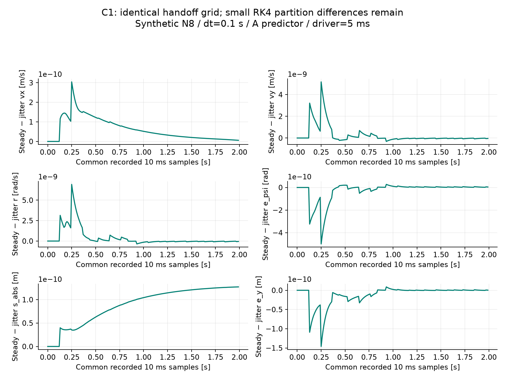
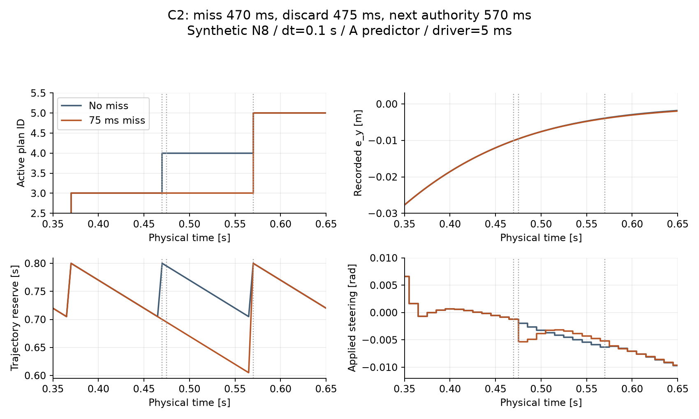
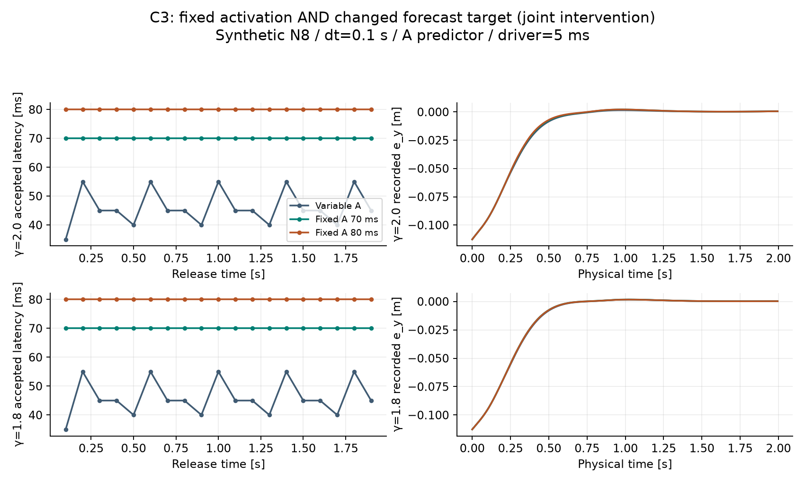
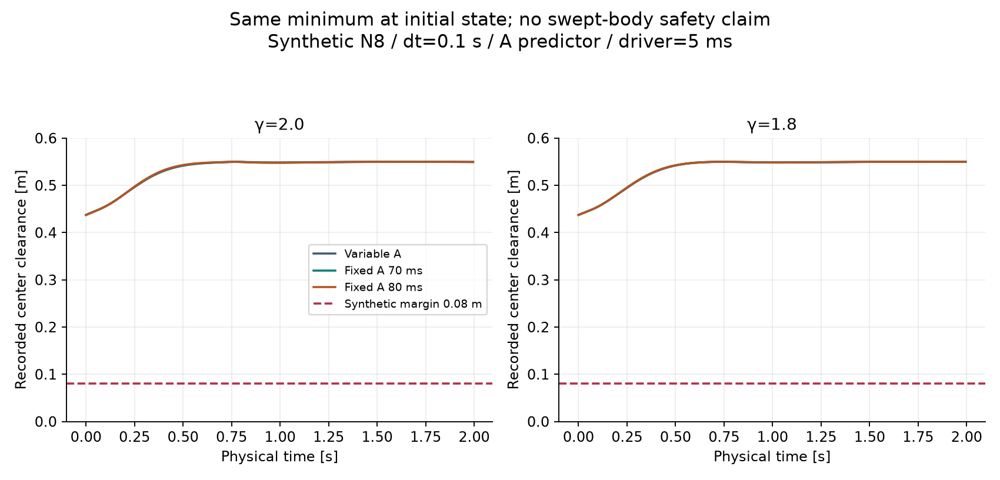
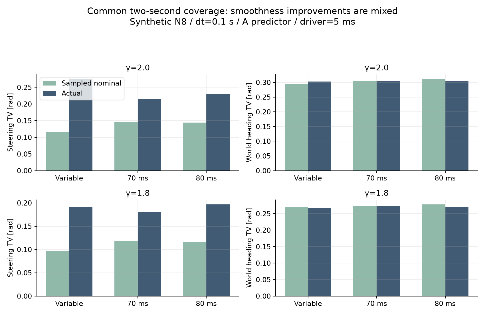
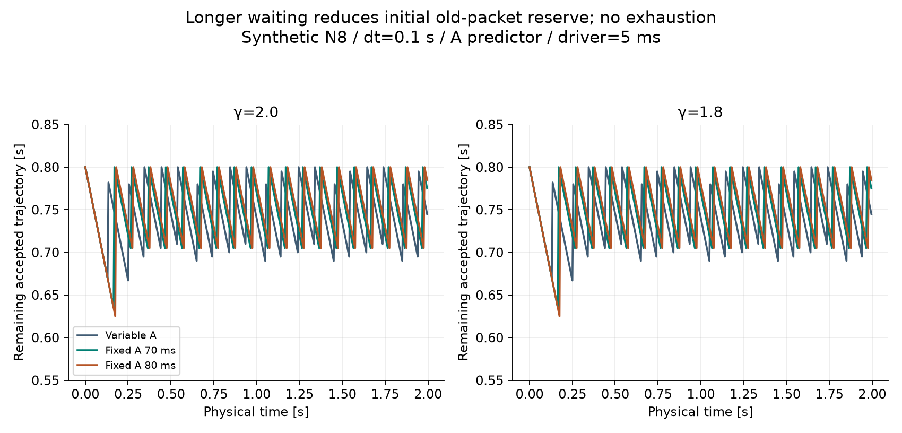
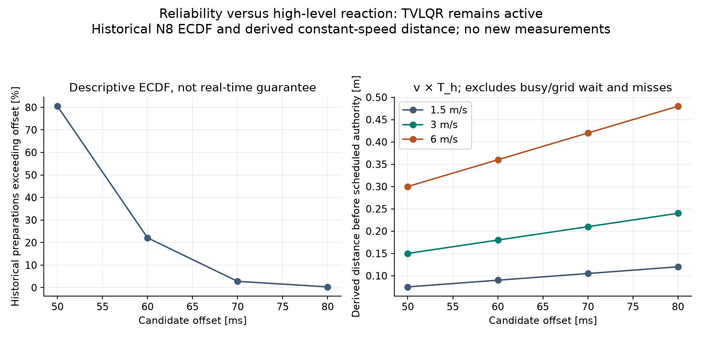

# Task007D-C — amended fixed-handoff pilot results

Current status: **COMPLETE, bounded research pilot only**. The original C0 blocked report is
retained verbatim below this report. Primary APEX's approved urgent-grid amendment resolves
that conflict. Baseline `c56e5095105cd1c70649127e246c48ee70c26428`; final delivery SHA is in Git
history and the Codex handoff. No production architecture is selected.

## 1. Task Completed

C0 contract implementation and tests, historical ECDF, two C1 jitter runs, one C2 miss run
(reusing C1 steady as reference), and six C3 runs completed. Nine new runs, each 2 s, sequential
fresh SINGLE workers. All pilot stop gates passed. No full laps or fresh measured repetitions.
The mandatory isolated C0 overrun intentionally retains exhaustion/fallback; it is not a racing
pilot success and has no accepted urgent-authority latency.

## 2. Scheduling Contract

Opt-in `AsyncConfig.fixed_handoff_offset`; default None. Fixed uses unchanged predictor A at
release plus prescribed offset and preserves the optimizer's nominal target timeline. Early
results wait, exact-deadline results may accept, and late packets permanently miss without
cancelling the solve. See [contract](TASK007D_C_FIXED_HANDOFF.md).

## 3. Event Ordering

Previously due actuator application → solver completion/readiness → scheduled acceptance or
miss → existing disturbance/fallback checks → codriver sampling/skip → nominal/urgent release →
physical propagation. A pending old-packet command survives handoff. No retrospective authority.

## 4. Grid Alignment

Every fixed runtime release and acceptance is on the global 10 ms grid. The retained counterexample
now defers .255 completion to .260 urgent release, giving .330 target. Original 155 ms delay
produces .415 completion/discard and a .330 miss. Separate 35 ms urgent result accepts at .330.
Busy wait 95 ms, grid wait 5 ms, fixed offset 70 ms, successful total urgent latency 170 ms.
Nominal coincidence services/coalesces demand; repeated latched triggers preserve the earliest wait.

## 5. Candidate Deadlines

Predeclared [protocol](task007d/c/amended/protocol.json) selected 70 ms for C1/C2 and 70/80 ms
for C3 **before outcomes**. 70 is near retained p95; 80 has a much smaller observed tail for
10 ms added reaction delay. 50/60 have large observed exceedance fractions. 90 was not justified.
Selection did not use progress/lap time.

## 6. Deadline ECDF

Five retained N8 gamma2 measured runs, 1,543 nonstartup preparations, no failed preparation.
Include the final host-prepared launch even if still physically pending at run end. Mean
55.950 ms; min 43.399, median 54.804, p90 66.266, p95 68.836, p99 72.427, max 184.045 ms.
Full observed samples and source hashes: [ECDF evidence](task007d/c/amended/ecdf/summary.json).

| Deadline | Exceedances | Observed fraction |
|---:|---:|---:|
| 50 ms | 1242/1543 | 80.493% |
| 60 ms | 341/1543 | 22.100% |
| 70 ms | 43/1543 | 2.787% |
| 80 ms | 5/1543 | 0.324% |

These are descriptive Mac observations, not hard-real-time/Raspberry Pi guarantees. Fixed-target
prediction can change preparation cost, so these fractions do not predict C's measured misses.

## 7. Chronology Test Results

C0's initial gate: 92 passes before racing. Final focused gate: **140 passed in 5.17 s**, including retained lightweight/forensics readers.
Tests cover all amended contract requirements, including two waiting completed commitments,
coalesced urgent demands, exact-deadline ordering, overdue busy work, stale/reserve/exhaustion,
old-command persistence, unchanged startup, deterministic replay and legacy A fingerprints.
Existing tests/tolerances were not relaxed. New arithmetic checks use 1e-12 absolute tolerance;
physical event comparisons retain the existing 1e-10 s convention.

## 8. Jitter-Decoupling Results

C1 steady readiness is 30 ms; jitter repeats 23/47/61/39 ms. All 19 runtime releases per run
are ready before the same 70 ms target. Release/accepted plan IDs and timestamps match to the
existing event tolerance; raw float timestamps/reserve are not claimed bitwise equal.
Packets 0 and 1 have identical numerical contents. First forecast/input/packet divergence is
plan 2 released at .200 s; first reference divergence above 1e-12 is at .270 s.

The first physical difference above 1e-12 is at .125 s, before the .170 first handoff.
The jittered .123 readiness splits the held-command .120–.125 step into 3+2 ms. Offline replay
with the unchanged plant reproduces both recorded endpoints exactly (see
[partition check](task007d/c/amended/partition_check.json)). Feedback first differs at .130 s;
subsequent forecasts/packets inherit the numerical difference. This verifies the originating
mechanism, not merely correlation with authority times. No integrator was changed.

| State | Common-event RMS difference | Maximum absolute difference |
|---|---:|---:|
| vx [m/s] | 8.30e-11 | 3.04e-10 |
| vy [m/s] | 8.33e-10 | 5.17e-9 |
| r [rad/s] | 1.13e-9 | 6.93e-9 |
| epsi [rad] | 8.66e-11 | 5.00e-10 |
| s_abs [m] | 9.69e-11 | 1.27e-10 |
| ey [m] | 2.67e-11 | 1.46e-10 |

400 common recorded samples through 1.995 s; 200 global-grid samples through 1.990 s retain
the small difference. Requested/applied steering max difference 3.08e-10 rad, acceleration
3.04e-10 m/s². Complete six-state/input/packet/reference statistics are in the compact summary.
This demonstrates strong practical decoupling for these subdeadline histories, not exact physical
invariance or a quantified reduction versus an unrun variable-mode C1 jitter pair.

## 9. Controlled Miss Results

C2 changes only plan 4's delay from 30 to 75 ms. Release .400, missed deadline .470,
completion/discard .475, no acceptance/use of plan 4. Plan 3 remains authoritative until plan 5
accepts .570. High-level authority gap is .370→.570 = 200 ms; missed deadline→recovery = 100 ms.
Ten driver samples continue during [.470,.570); vehicle progress increases over 0.53 m between
recorded endpoints in that interval. Minimum reserve 0.605 s, versus 0.635 reference. No fallback.
Lateral tracking RMS rises from 0.000494 to 0.000719 m; steering TV from 0.21401 to 0.21780 rad.
These unfavorable effects and full common-time state differences are retained.

## 10. Variable-Handoff Baseline

C3 readiness repeats 35/55/45/25 ms, with 5 ms codriver delay. Both gamma2.0 and gamma1.8
finish the same 2 s coverage. Release times match across each trio. All 19 runtime packets
accept. The rolling estimator is unchanged; actual accepted latency is 35–55 ms. C3 changes
both handoff schedule and forecast target, so controller differences cannot be credited solely
to fixed scheduling. First forecast split is at .100; variable authority starts .135; first
reference/command divergence is at .140, application divergence at .145, and first recorded
physical-state divergence above 1e-12 at .150 s, in all four variable/fixed pairs.

## 11. Fixed-Handoff 50 ms

ECDF evaluated, no closed-loop run authorized.

## 12. Fixed-Handoff 60 ms

ECDF evaluated, no closed-loop run authorized.

## 13. Fixed-Handoff 70 ms

19/19 accepted per C3 demand level, 0 fixed deadline misses. Wait 15–45 ms after readiness;
release-to-authority and first TVLQR use 70 ms (first resulting actuator request applies 5 ms later). Lower applied-steering TV and all six tracking RMS
values than variable mode at both demands. Initial minimum reserve falls from 0.667 to 0.635 s.

## 14. Fixed-Handoff 80 ms

19/19 accepted per C3 demand level, 0 fixed deadline misses. Wait 25–55 ms; authority/first use
80 ms. Lower all-state tracking RMS than variable A, but gamma1.8 applied-steering TV is worse
(0.19695 vs 0.19224 rad). Relative to 70 ms, yaw-rate/progress RMS improves while vx/vy/heading/
lateral RMS worsens. Initial reserve is 0.625 s.

## 15. Optional 90 ms

Not selected; no additional ECDF candidate or closed-loop run justified for this bounded pilot.

## 16. Track Clearance

All six C3 runs have minimum recorded center clearance 0.437314 m, right boundary at the shared
initial state, or 0.357314 m above the retained 0.08 m synthetic tracking margin. No recorded
boundary crossing. There is no demonstrated clearance gain. Left/right time series are retained;
recorded center clearance is not continuous swept-body or physically validated safety.

## 17. Slack

Maximum predicted slack across all pilot plans is below 9.10e-11 m; none exceeds the 1e-6 m gate.
No tuning or changed slack thresholds were used.

## 18. Tire / Beta

At gamma2, maximum front/rear utilization is 0.33735/0.36460 and |beta| about 0.06266 rad;
at gamma1.8, 0.29718/0.31665 and 0.05039 rad. All recorded values are finite, no model-domain
failure. Minimum Frenet denominator across C3 is 0.999976. Full per-case values in metrics table.

## 19. Steering / Rate

Maximum steering utilization is 0.14994 (gamma2 variable), below the synthetic angle bound.
Existing rate limit reaches 1 rad/s. Rate-limit occupancy is 9/6/7% for gamma2 variable/70/80,
and 4/5.5/6% for gamma1.8. Thus fixed does not uniformly reduce rate-limit occupancy. Reversals
and rate RMS/max are tabulated separately from nominal controls.

## 20. Smoothness

Common recorded 0–1.995 s coverage (commands sampled through 1.990, applied through 1.995):

| Gamma | Mode | Applied steering TV [rad] | Actual world heading TV [rad] | Applied acceleration TV [m/s²] |
|---:|---|---:|---:|---:|
| 2.0 | Variable | 0.275150 | 0.302428 | 1.328450 |
| 2.0 | 70 ms | 0.214007 | 0.305141 | 1.157124 |
| 2.0 | 80 ms | 0.230517 | 0.305174 | 1.153764 |
| 1.8 | Variable | 0.192243 | 0.267572 | 1.035823 |
| 1.8 | 70 ms | 0.180020 | 0.272906 | 0.841036 |
| 1.8 | 80 ms | 0.196946 | 0.270493 | 0.836567 |

70 ms steering reduction is 22.2%/6.36%; 80 ms is −16.2%/+2.45% change. Heading TV rises for
both fixed offsets at both demands. Nominal steering TV rises even where applied TV falls;
planned and actual quantities are not interchangeable. See full metric and figure evidence.

## 21. APEX→Vehicle Tracking

All six canonical-state RMS values improve in C3 fixed versus variable, but maximum heading
error worsens: gamma2 0.02166→0.02353/0.02423 rad; gamma1.8 0.01614→0.01888/0.01892 rad.
Heading residuals are wrapped. Every state RMS/max is separately tabulated in
[metrics](task007d/c/amended/metrics.md), preserving these regressions. Errors are against each
run's active APEX reference, which itself changes. No racing-performance superiority is inferred.

## 22. Timing Metrics

Every cycle has release, readiness, target (fixed valid_from or separate variable forecast target),
acceptance, first TVLQR use, expiry, preparation duration, waiting, deadline margin, status,
packet age, consecutive misses and reserve. Missing/not-applicable timestamps are null in JSON
and blank in CSV. Readiness-state mismatch remains distinct from same-time accepted-handoff
continuity and target-time prediction error. Imposed delays determine physical timing; recorded
host wall/CPU durations are descriptive only. All 171 offline A forecasts match runtime NMPC
state/previous-input inputs exactly (19 per run).

## 23. Deadline Reliability

Seven fixed racing runs have 133 commitments: 132 accepted, one deliberately missed in C2,
zero unexpected misses; C3 specifically has 76/76 accepted. Both variable baselines have 19
accepted each and no fixed deadline concept. There are no planner-busy misses, codriver-busy
ticks, failed solves, invalid chronology or unexpected fallback in the pilots. C0 separately
retains consecutive misses and fallback. Observed counts are not historical ECDF estimates.

## 24. Trajectory Reserve

C3 minimum reserve variable/70/80 is 0.667/0.635/0.625 s at both demands. Fixed packets begin
with 0.8 s at acceptance, while startup waits longer for its first replacement. C2 minimum
0.605 s remains positive. No reserve exhaustion in racing pilots. Packet age is measured from
release; it does not imply an already-expired nominal timeline.

## 25. Responsiveness Cost

At 50/60/70/80 ms the ideal distances before scheduled authority are respectively
0.075/0.090/0.105/0.120 m at 1.5 m/s, 0.150/0.180/0.210/0.240 m at 3 m/s, and
0.300/0.360/0.420/0.480 m at 6 m/s. These v×T_h values exclude busy/grid wait and missed cycles.
Actual C3 acceptance waits are 70 or 80 ms versus variable 35–55 ms. In the successful C0
urgent example total response is 170 ms, not 70 ms. TVLQR continues using the previous valid
trajectory throughout normal waiting and missed handoffs.

## 26. RK4 / Event Findings

C1 steady: 400 segments of approximately 5 ms; jitter: 419 segments, 1–5 ms, with 19 off-grid
readiness events creating 19 extra boundaries. Both have 19 accepted handoffs and 200 application
boundaries. C3 has 19 nonglobal-grid readiness events per run, all on existing 5 ms application/
plant boundaries: 400 segments remain, no extra readiness-only partition. Coincident event counts
overlap and must not be added as distinct partitions. Original segment timestamps/durations are
retained. Differences remain on common 10 ms samples. Common-progress comparisons use derived
linear interpolation of common-grid recorded samples, strictly within overlapping coverage;
interpolation is not independently sampled truth.

## 27. Required Figures

All nine generated from saved numerical tables; rendered images were reviewed for legibility.

## 28. Regression Tests

**696 passed in 649.73 s (10 min 49.73 s)**. Scoped Ruff lint/format: **passed (16 files)**. The first full run had 693 passes and two legacy-reader failures: the old parser enumerated
all dataclass fields and incorrectly required omitted optional `valid_from` metadata. A minimal
compatibility change in `scripts/task007d/forensics.py` preserves old records and accepts new
metadata; a new round-trip test covers both. No old artifact, fingerprint or tolerance changed.
The initial failure log is retained under the new ignored evidence directory. Existing legacy fingerprint assertions,
mathematical tolerances and model/controller equations are unchanged. See verification evidence.

## 29. Generated Artifacts

Three amended documents retaining original blocked findings; ADR-160; current handoff;
opt-in scheduler/packet metadata; focused tests; bounded worker, ECDF, offline tables/analysis,
partition check and figure scripts. Compact protocol, ECDF, summaries, source/fixture/vehicle
hashes and CSV data are under `docs/task007d/c/amended/`. Raw states/packets/controls/release
snapshots/segments/worker logs remain ignored under `results/task007d/c/amended/`.
Historical D0–D5/D-P evidence was preserved; no raw archives are committed.

## 30. Known Limitations

Synthetic short traces from one initial fixture, no physical identification or full-lap result.
C1 has no matched variable-handoff jitter pair, so practical fixed-mode stability is established
without a direct sensitivity-reduction ratio. C3 confounds changed target with changed scheduling.
No fresh measured reliability or repeated statistical campaign; host timings are not portable.
Recorded validity extrema are sample-based. End-of-simulation has no new deadline at exactly 2 s.

Two export-development failures were retained/documented: initial analysis used scalar angle wrapping
on an array; initial C0 JSON export encountered a NumPy boolean. Both were offline/export issues,
fixed without rerunning or replacing any pilot. An earlier C1 launch was never executed because
approval review hit a usage limit; the resumed normal approval path succeeded. No unfavorable
scientific run was discarded. Final analysis restricts progress interpolation to common-grid
samples to avoid artificial differences caused by unequal sampling density.

## 31. Architecture Deviations

Only the explicitly approved fixed-mode urgent gating, fixed commitment eligibility and necessary
ready-commitment storage were implemented. Repeated urgent-trigger telemetry preserves coalescing;
this bookkeeping fix does not affect release policy/physical results. No B or lightweight predictor
activation, scheduler rounding, solver cancellation, parallel solves, model/integrator/optimizer/
TVLQR changes, production-default changes or subsequent task work. A default; B experimental;
P0/P1a/P1b unselected; C research only. No System Identification, LMPC, adaptive codriver,
energy/opponent handling or Performance/Efficiency freeze.

## 32. Recommended T_h

**Retain 70 ms as the leading bounded-test candidate, with 80 ms as a reliability comparator.**
70 has lower reaction cost, larger startup reserve and generally better lateral/heading/speed
tracking and steering TV than 80. 80 has a smaller historical exceedance tail and better yaw RMS,
but current imposed C3 timings deliberately cannot test reliability differences. No production
selection and no hard deadline guarantee follow from this recommendation.

## 33. Is Architecture C Worth Continuing?

Yes, a separately authorized staged investigation is scientifically justified; a full measured
racing campaign is not yet established as safe/useful by two seconds of evidence. A/B/C/D/E/F/G
answers: fixed timing decouples authority from subdeadline readiness here, small verified RK4
partition differences remain; 70 leads the bounded tradeoff; actual miss count is one imposed C2
miss; tracking RMS and steering often improve but clearance does not, heading TV/peak error can
worsen, and high-level response is slower. First perform bounded measured deadline-cost/reliability
checks and a matched variable C1 jitter control before considering wider campaigns.

## 34. Is Architecture B Comparison Now Justified?

A future separate, bounded causal comparison could be informative because fixed scheduling is now
verified and A has known latency approximation limits. This task supplies no B-under-fixed evidence;
D5 unfavorable clearance and D-P nonselection remain relevant. B integration/comparison requires
new authorization and is not recommended as a production change.

## 35. Recommended Next Step

Engineering Orchestrator review of the contract, explicit completed-commitment storage and mixed
results. If approved separately, a short measured 70/80 ms feasibility study plus matched variable
jitter control can resolve the principal remaining reliability/attribution gaps. Do not launch it
from this delivery. **STOP AFTER TASK007D-C.**

## 36. Reproduction Commands

See [reproduction guide](TASK007D_C_REPRODUCTION.md). It includes C0 fixtures/tests, ECDF,
predeclared sequential workers, compact export, partition replay, figures, full regression and
Ruff. Fresh output directories and measurement/disk guards are mandatory.

---

# Historical original C0 blocked report (retained verbatim)

# Task007D-C — C0 blocked results and Engineering Orchestrator handoff

## 1. Task Completed

**BLOCKED, not complete.** C0 inspection and its urgent-grid counterexample are complete;
fixed-mode implementation and the remaining C0 acceptance tests are not. C1–C3 were not executed.
Baseline/main: `3564bb394c7f49cf430d6f0f976bea153a5da822`. The mandated stop condition is an
observed urgent release at 0.255 s; adding a 70 ms offset yields 0.325 s, outside the global
10 ms grid. See [contract audit](TASK007D_C_FIXED_HANDOFF.md) and [reproduction](TASK007D_C_REPRODUCTION.md).

## 2. Scheduling Contract

Required: exact `valid_from=t_release+T_h`, grid-aligned acceptance, preserved urgent semantics,
early waiting, exact-deadline readiness before acceptance, late permanent discard without solve
cancellation. These cannot all hold for the observed off-grid urgent release. No fixed setting,
packet field or runtime scheduling change was implemented. A remains the default predictor.

## 3. Event Ordering

Verified unchanged ordering: previously due actuator application; preparation completion;
waiting packet acceptance; disturbance/exhaustion; codriver tick; nominal or urgent release;
zero-duration continuation or physics. Completion clears pending before urgent release at the
same timestamp. Pending old-packet commands retain their originating plan ID. No C ordering
claim is made beyond the required contract documented in the audit.

## 4. Grid Alignment

An urgent request latches at 0.160 s while packet 1 (released 0.100 s) is busy. Its readiness
at 0.255 s immediately launches urgent packet 2. Every eligible T_h=n*10 ms preserves the
release's 5 ms off-grid phase. This is much larger than the 1e-10 s event tolerance. The separate
unblocked-urgent fixture releases on-grid at 0.050 s; the conflict specifically includes busy
completion behavior. Rounding takeover, delaying release or suppressing urgent work requires
an explicit policy revision, not a numerical fix.

## 5. Candidate Deadlines

All eligible offsets 10–100 ms were checked **algebraically for grid compatibility**, not for
reliability. All fail for this release. C1/C3 candidates were not selected because C0 stopped.
No 50/60/70/80 ms racing result or ranking exists in this delivery.

## 6. Deadline ECDF

**NOT EXECUTED.** Historical N8 preparation records were not reanalyzed after the C0 stop.
No sample count, quantile, maximum or exceedance estimate is fabricated. The assignment's
approximate historical values are not a newly measured Architecture C reliability result.

## 7. Chronology Test Results

68 focused tests passed in 4.72 s: four new stop-gate tests plus 64 retained chronology,
diagnostic timing, predictor/runtime and tracker tests. The existing default-A fingerprints
for states, handoffs, releases, misses, controls, forecasts and solver inputs pass unchanged.
The reproducer confirms no overlapping solve, old authority/TVLQR/plant continuation during
busy work, unchanged startup, on-grid versus off-grid urgent cases and deterministic replay.
Fixed-mode early/exact/late acceptance, deadline misses, stale/expired handling, consecutive
misses and packet-age/reserve tests remain **NOT EXECUTED** because no fixed mode was built.

## 8. Jitter-Decoupling Results

**NOT EXECUTED — C1 gated by C0.** No sensitivity reduction or same-packet equivalence is claimed.

## 9. Controlled Miss Results

**NOT EXECUTED — C2 gated by C0.** The C0 155 ms fixture is a legacy planner-busy counterexample,
not the requested fixed 70/75 ms miss pilot. It has no fixed miss/discard/acceptance timestamps.

## 10. Variable-Handoff Baseline

Production variable behavior and default fingerprints are preserved. No new N8 gamma2.0 or
gamma1.8 baseline campaign was run. The only new raw physical trace is the existing isolated
straight-chart test at vx=2 m/s, with a deterministic planner and no NMPC solve.

## 11. Fixed-Handoff 50 ms

**ECDF NOT EXECUTED; no closed-loop run performed.** Hypothetical C0 target 0.305 s is off-grid.
The usual phrase “ECDF evaluated” would be inaccurate after this early stop.

## 12. Fixed-Handoff 60 ms

**ECDF NOT EXECUTED; no closed-loop run performed.** Hypothetical C0 target 0.315 s is off-grid.

## 13. Fixed-Handoff 70 ms

**ECDF NOT EXECUTED; no closed-loop run performed.** Hypothetical C0 target 0.325 s is off-grid.

## 14. Fixed-Handoff 80 ms

**ECDF NOT EXECUTED; no closed-loop run performed.** Hypothetical C0 target 0.335 s is off-grid.

## 15. Optional 90 ms

**NOT SELECTED; ECDF/closed-loop analysis NOT EXECUTED.** No feasibility justification was made.
The general offset-grid proof includes this offset without selecting it for a pilot.

## 16. Track Clearance

**NOT EXECUTED for C3.** All prior D3/D4/D5/D-P evidence remains preserved, including the adverse
R4-B recorded center-clearance result. The wide straight unit-test chart is not racing clearance
evidence or continuous swept-body certification.

## 17. Slack

**NOT EXECUTED.** The deterministic C0 planner has no optimizer slack variables. No synthetic
zero-slack result is substituted for a fixed-mode NMPC measurement.

## 18. Tire / Beta

**NOT EXECUTED for C3.** Existing plant diagnostics ran in the unit fixture without a reported
model failure; no gamma2/gamma1.8 tire-utilization or beta comparison was performed.

## 19. Steering / Rate

Existing requested/applied controls and their source plan IDs are preserved in C0 raw evidence.
Repeat fixture controls match exactly. **C3 utilization/reversal/rate-occupancy comparisons NOT
EXECUTED.** No physical law or clamp was changed.

## 20. Smoothness

**NOT EXECUTED.** No fixed/variable heading, steering or acceleration variation ranking exists.
A short straight counterexample cannot establish racing smoothness improvement.

## 21. APEX→Vehicle Tracking

**NOT EXECUTED for C3.** No six-state N8 tracking RMS/max comparison is available. C0 verifies
that the existing urgent threshold can latch while the planner is busy; it is not an optimizer
performance test. Canonical ordering and angle conventions remain unchanged.

## 22. Timing Metrics

Observed C0 times: release 0.100 s; urgent trigger 0.160 s; busy nominal miss 0.200 s; readiness
and subsequent urgent release 0.255 s. Urgent packet 2 completes at 0.410 s, with nominal busy
misses at 0.300/0.400 s. These are existing variable-mode events. Fixed valid_from, acceptance,
wait, deadline margin and consecutive fixed misses are **not applicable**, not fabricated zeros.
There was no fictional cancellation and no parallel planner launch.

## 23. Deadline Reliability

**NOT EXECUTED.** No actual Architecture C handoff deadline was scheduled. Planner-busy misses
in the unit fixture must not be counted as fixed-handoff misses or historical ECDF estimates.

## 24. Trajectory Reserve

Existing reserve and old-packet continuation checks pass; the counterexample has no fallback
or reported failure. Fixed acceptance reserve/age, consecutive deadline-miss reserve and
exhaustion outcomes are **NOT EXECUTED**. Existing warning/critical/minimum rules are untouched.

## 25. Responsiveness Cost

Analytical constant-speed distance `d=v*T_h` only, not observed trajectory or actual authority
latency. A missed deadline or deferred release can increase real high-level reaction time.
TVLQR remains active on the prior accepted trajectory during ordinary waiting/busy work.

| T_h | At 1.5 m/s | At 3.0 m/s | At 6.0 m/s |
|---:|---:|---:|---:|
| 50 ms | 0.075 m | 0.150 m | 0.300 m |
| 60 ms | 0.090 m | 0.180 m | 0.360 m |
| 70 ms | 0.105 m | 0.210 m | 0.420 m |
| 80 ms | 0.120 m | 0.240 m | 0.480 m |

## 26. RK4 / Event Findings

Source inspection confirms that pending readiness participates in `next_time`, so it can split
RK4 without changing authority. The observed 0.255 s event is off the codriver grid but lies on
a 5 ms plant subdivision; no numerical divergence is inferred from this alone. C1/C3 partition
counts, segment extrema and common-grid state comparisons are **NOT EXECUTED**. No integrator
change was made to enforce agreement.

## 27. Required Figures

All nine are **NOT GENERATED**, because the required experiments/ECDF are gated. No placeholder
or fabricated traces were substituted:

1. `task007dc_fixed_handoff_timeline.png`
2. `task007dc_deadline_ecdf.png`
3. `task007dc_jitter_decoupling.png`
4. `task007dc_deadline_miss.png`
5. `task007dc_variable_vs_fixed_handoff.png`
6. `task007dc_track_clearance.png`
7. `task007dc_smoothness.png`
8. `task007dc_reserve.png`
9. `task007dc_responsiveness_tradeoff.png`

The observed C0 timeline is a numerical table in the contract audit, not a fixed-scheduler
result. Prior D-P figures were neither regenerated nor edited.

## 28. Regression Tests

68 focused passes; scoped Ruff lint/format pass. Full-suite execution is **deferred**, not passed:
it contains NMPC/multilap integration simulations and C0 has not cleared the required prerequisite.
No existing tests, expected fingerprints or tolerances were modified. Source hashes and final
preservation checks are in [verification.json](task007d/c/verification.json).

## 29. Generated Artifacts

Three documents: this 36-section results report, the contract audit and reproduction guide.
One isolated audit/export script and four new tests. Compact evidence under `docs/task007d/c/`:
`c0_summary.json`, `offset_grid_audit.csv`, `verification.json`. Ignored raw evidence:
`results/task007d/c/c0_urgent_grid/{raw,summary}.json`. Handoff updated; no ADR or roadmap edit
because no alternate urgent policy or scheduling architecture was selected.

## 30. Known Limitations

This proves a scheduling-contract conflict, not that fixed handoff is scientifically ineffective.
No C production code, frozen racing pilot, measured preparation campaign or ECDF result exists.
The analytic straight fixture and synthetic vehicle are not physically identified APEX data.
Only legacy behavior and the counterexample are verified. C0 acceptance coverage remains incomplete.

## 31. Architecture Deviations

**None implemented.** Specifically no rounding, urgent suppression/deferment, scheduler queue,
solve cancellation, predictor change, new physical model, estimator change, packet schema change,
B integration or lightweight runtime activation. C remains a proposed opt-in research mode.
A default, experimental B and the D-P nonselection remain intact. No System Identification,
LMPC, adaptive codriver, opponent handling, energy work or controller/profile freezing began.

## 32. Recommended T_h

**Undetermined.** All grid-aligned offsets share the urgent-phase conflict. No deadline ranking
from lap time or unexecuted reliability data is justified. Resolve the release policy, complete
C0, then conduct the required ECDF selection before observing C3 outcomes.

## 33. Is Architecture C Worth Continuing?

**Further contract work is justified; a larger measured campaign is not yet justified.**
Decision questions A/B/C/D/E/F/G remain unmeasured: there is no jitter, partition-causality,
best-offset, actual fixed-miss, improvement or staleness result. This stop concerns incompatible
requirements rather than a negative physical comparison.

## 34. Is Architecture B Comparison Now Justified?

**Not by new C evidence.** No C pilot ran, so question H cannot be answered affirmatively from
this task. Existing B evidence is unchanged. Finish an authorized A-only C investigation first.

## 35. Recommended Next Step

Engineering Orchestrator should explicitly resolve off-grid urgent releases. One defensible
option for review is fixed-mode-only deferred urgent launch at the next codriver grid tick,
keeping a running solve pending until completion. This changes urgent latency and requires
approval; it was not implemented. Alternatively revise exact-offset or grid-alignment requirements.
Then resume bounded C0 implementation/testing before C1–C3. Do not bypass the stop by disabling
urgent behavior, silently rejecting its work or choosing favorable timing histories.

## 36. Reproduction Commands

See [TASK007D_C_REPRODUCTION.md](TASK007D_C_REPRODUCTION.md) for the exact focused test, Ruff,
SINGLE fixture export and compact evidence commands. They reproduce only the C0 conflict.
Normal commit/push follows the standing workflow; exact delivery SHA/URL is reported in the final
handoff and Git history. **STOP at C0. Await Engineering Orchestrator review.**
