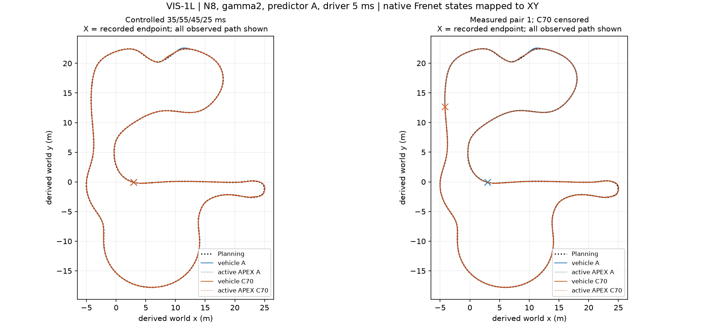
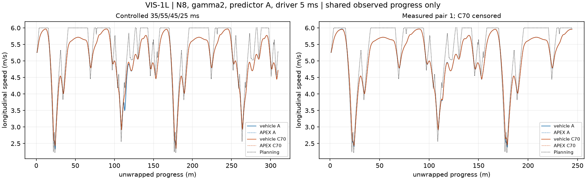
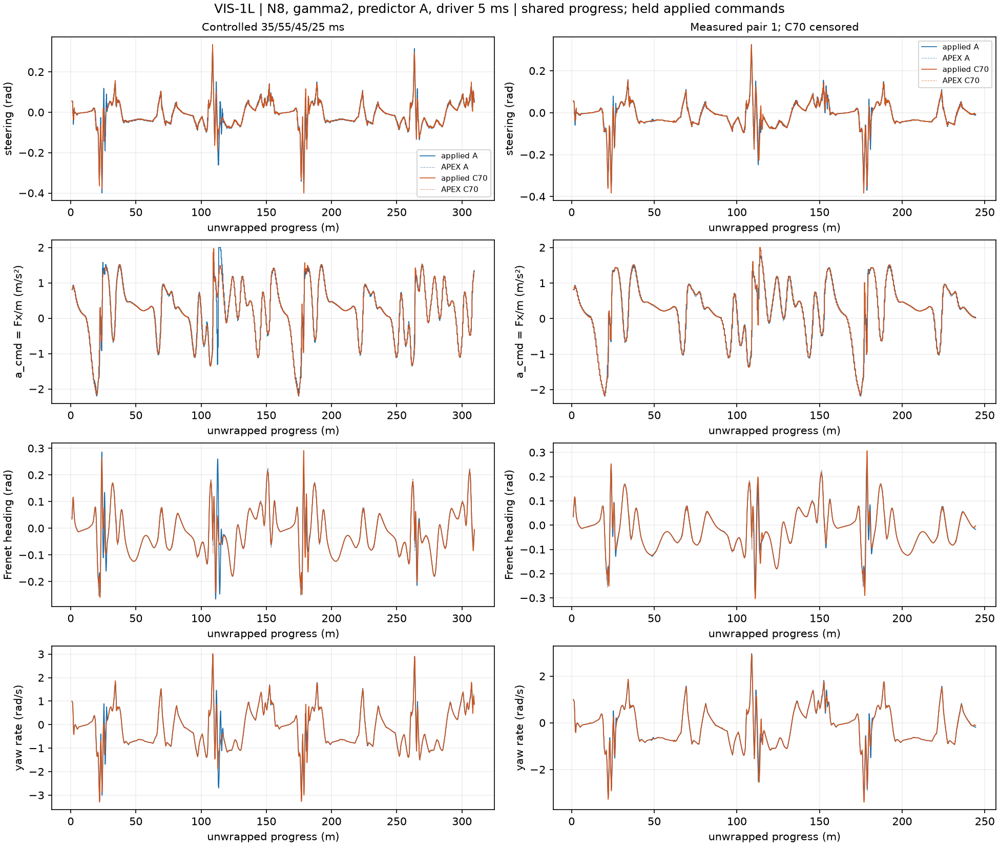
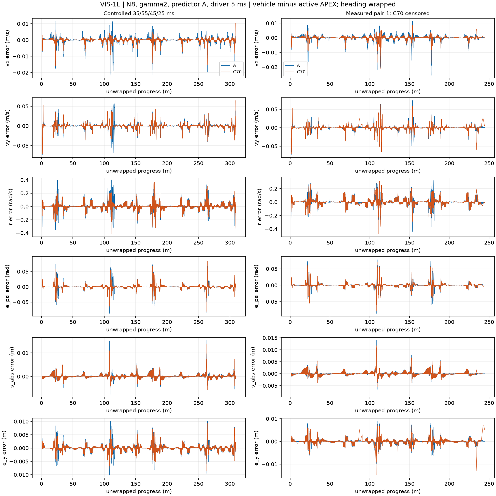
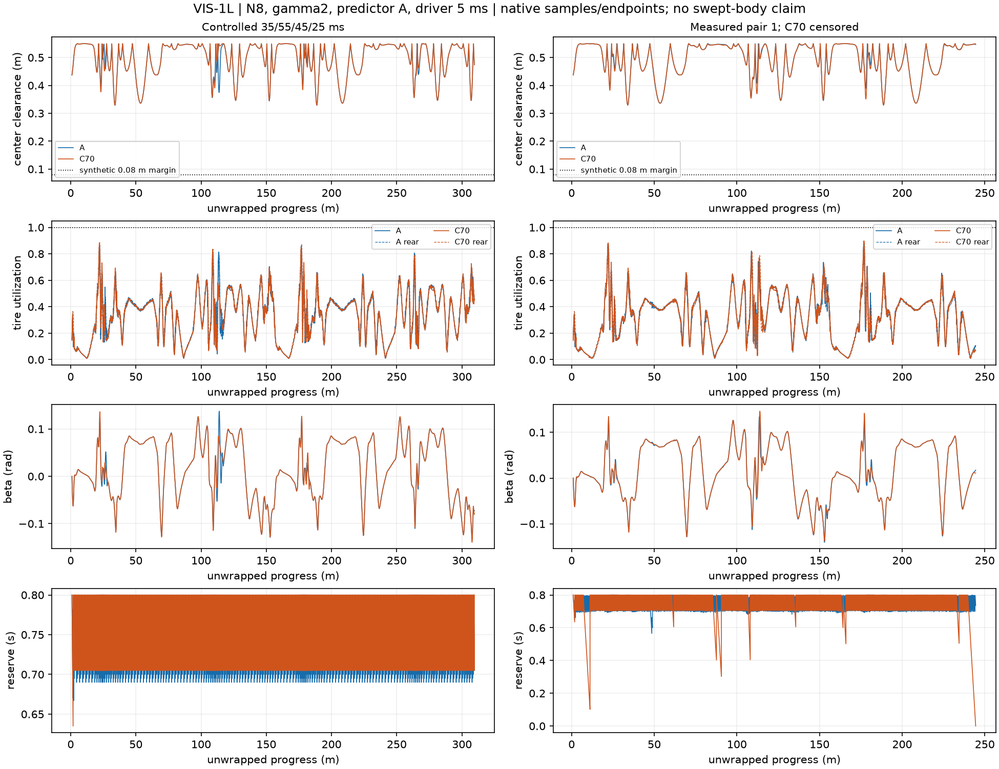
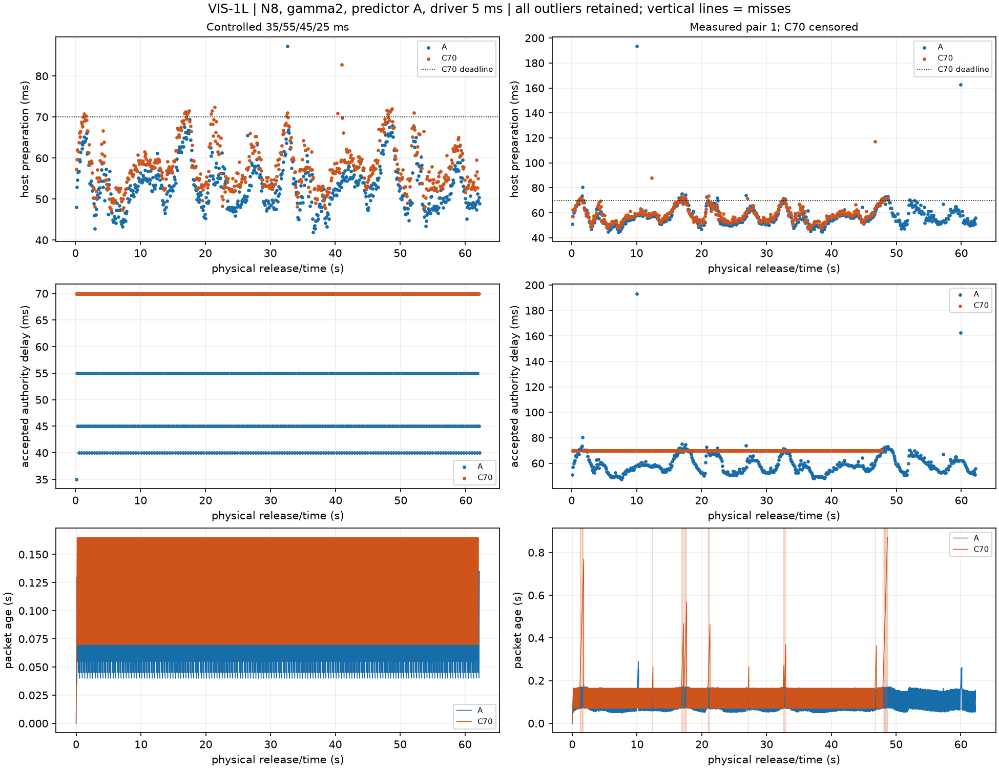
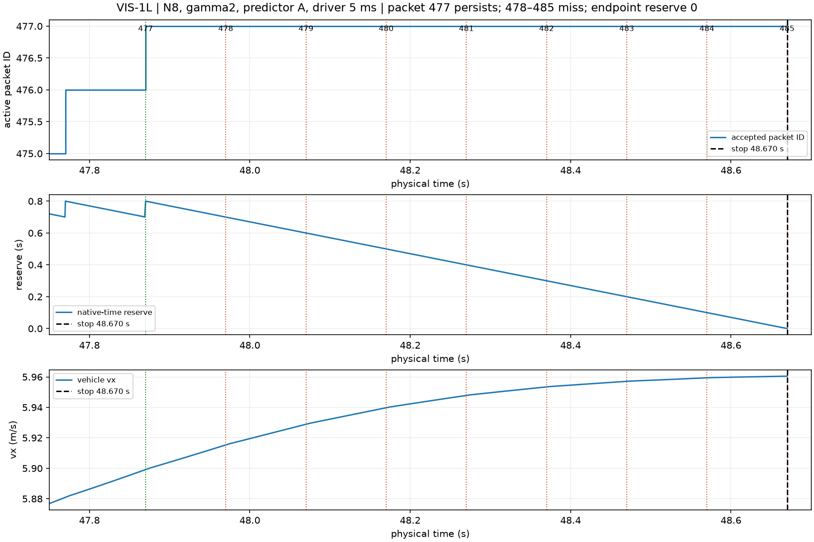
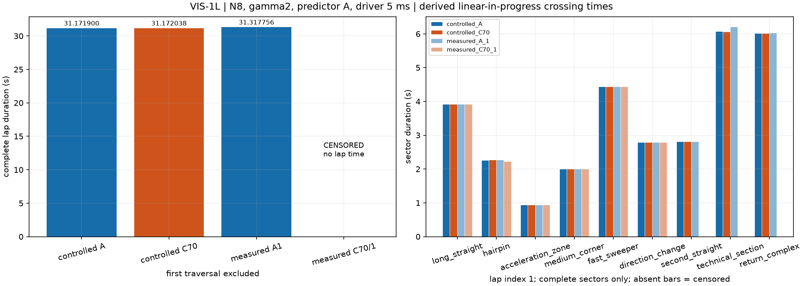

# Task007D-VIS / VIS-1L — existing-track long-run results

**Status: BLOCKED — documented scientific stop; partial WORK for Engineering Review.**
Four of six authorized long workers ran sequentially. Three completed the entire pipeline.
Measured C70/1 exhausted its active trajectory at **48.670 s** after eight consecutive missed
handoffs, then its offline event export raised a serialization error. The last two workers
were not launched. No unfavorable outcome was replaced; no runtime repair or retuning occurred.

The controlled pair each completed one lap, but measured C70 completed only the initial partial
traversal. These results do not support C70 promotion or VIS-2 progression without review.

## Source, prerequisites and protocol

All four workers used clean main **8dbd1c5fbc09781411fc762e04f9c2c5cf2d99ae**, a documentation-only
descendant of frozen executable **c6990572045e61ee443dc715de9e8c44396e5b41**. All 294 prior
source/test/dependency hashes and the accepted fixture/vehicle hashes matched before launch.
The accepted VIS-1R parity workers, 19 exact C3 groups and 19 causal forecasts each, complete
packages and 414 applicable prerequisite cases were revalidated/reused rather than rerun.
See [preflight](task007d/vis/vis1l/evidence/vis1l_preflight.json),
[VIS-1R](TASK007D_VIS1R_RECOVERY.md), [protocol](TASK007D_VIS_PROTOCOL.md),
[provenance](task007d/vis/vis1l/provenance.json) and the [reproduction guide](TASK007D_VIS1L_REPRODUCTION.md).

Frozen synthetic_grand_prix_v1 gamma2 Planning fixture; N8, dt=0.1 s, H=0.8 s,
Q=diag(4,4,1,200,200), R=diag(25,1), W=diag(1,0.1), lambda_s=0. Predictor A in both modes;
variable handoff A versus fixed 70 ms C70. TVLQR 100 Hz, plant, combined-grip tires, IPOPT,
warm starts, actuator limits and the 0.08 m synthetic tracking margin are unchanged.
Controlled readiness repeats 35/55/45/25 ms; measured readiness uses actual preparation wall time.
All runs impose 5 ms codriver latency, request two seam crossings and cap physical time at 80 s.
No forecast targets were forced equal: the first runtime A target is 0.117 s versus C70 0.170 s.

The four scientific workers ran before any new report code was added. Only new offline reporting,
its tests and documentation are delivered; existing research scripts and all runtime code are unchanged.
The containing delivery commit identifies the report-tool revision, separately from the scientific SHA.

## Execution and coverage

| Case | Worker / package | End (s) | Crossings / full laps | Full-lap time (s) | Progress (m) |
| --- | --- | --- | --- | --- | --- |
| controlled_A | exit 0 / valid | 62.235000 | 2 / 1 | 31.171900 | 309.534054 |
| controlled_C70 | exit 0 / valid | 62.075000 | 2 / 1 | 31.172038 | 309.539867 |
| measured_A_1 | exit 0 / valid | 62.285000 | 2 / 1 | 31.317756 | 309.531303 |
| measured_C70_1 | exit 1 / incomplete | 48.670000 | 1 / 0 | — | 244.487304 |

`measured_C70_2` and `measured_A_2`: **NOT EXECUTED — campaign scientific stop**.
Track length is 154.76345492731022 m; start s_abs=1 m. Crossing 1 ends the initial partial
traversal; only crossing 1→2 is a complete lap. The controlled full-lap difference is C70 minus
A = **+0.000137869 s**, far below the 5 ms crossing brackets; it is not an established racing gain.
The 0.16 s difference in overall completion times largely comes from the initial partial traversal.
Measured A's full lap is 31.317756 s; measured C70 has **no observed full-lap time**.

Crossing/sector times are derived by linear progress inside original RK4 brackets, not independent
physical samples at seams. Every bracket is retained. Scientific extrema use native events plus
the recorded final integration endpoint. No new plant integration or trajectory extrapolation occurs.

| Lap-index-1 sector | Controlled A (s) | Controlled C70 (s) | Measured A1 (s) | Measured C70/1 (s) |
| --- | --- | --- | --- | --- |
| long_straight | 3.905054 | 3.906462 | 3.906216 | 3.906938 |
| hairpin | 2.255349 | 2.262169 | 2.263456 | 2.212738 |
| acceleration_zone | 0.925541 | 0.927038 | 0.925448 | 0.925639 |
| medium_corner | 1.992813 | 1.991704 | 1.991994 | 1.991600 |
| fast_sweeper | 4.427693 | 4.427470 | 4.426897 | 4.427469 |
| direction_change | 2.783790 | 2.782905 | 2.783713 | 2.783018 |
| second_straight | 2.805648 | 2.805610 | 2.805374 | 1.471642 (partial) |
| technical_section | 6.062576 | 6.055308 | 6.197641 | NOT OBSERVED |
| return_complex | 6.013436 | 6.013372 | 6.017016 | NOT OBSERVED |

All run/lap/sector rows, including initial partials and the tiny recorded post-seam tail, are in
[lap_sector_metrics.csv](task007d/vis/vis1l/lap_sector_metrics.csv). Partial sectors cannot be
compared as completed sector times. Progress rates and their exact windows are retained there.

## Measured C70 stop and export failure

485 runtime releases produced 455 accepted handoffs and **30 missed fixed deadlines (6.19%)**.
Twenty-two misses were followed by a later accepted packet; the final eight were not.
This is one correlated, censored host run, not an independent-trial reliability estimate.
All 30 records, recoveries and nulls are in [misses.csv](task007d/vis/vis1l/misses.csv).

Packet 477 released at 47.800 s, became ready at 47.868902625 s and was accepted at 47.870 s.
It remained authoritative through its expiry at 48.670 s. Packets 478–485 missed their
47.970, 48.070, …, 48.670 s deadlines. Packets 478–484 completed/discarded 0.269–2.101 ms late;
none activated. Packet 485's host preparation took 72.029625 ms, scheduling completion at
48.672029625 s, **outside physical coverage**. Its observed readiness and discard remain null.
A known deadline outcome is distinct from an observed solver-completion event: timing's
`resolved=485, censored=0` counts deadline outcomes; physical completion is censored for one cycle.

The last raw reserve event at 48.665 s reports 0.005 s. The original terminal RK4 endpoint at
48.670 s reaches **zero reserve**; the native-window minimum correctly includes it. The older
`physical.minimum_reserve` summary remains unchanged at 0.005 s because it uses reserve-event rows.
These are different coverage definitions, not evidence of remaining reserve at termination.
TVLQR and physical motion continued under packet 477 until exhaustion. At the endpoint vx was
5.960447591 m/s; the existing baseline fallback is valid only for 1≤vx≤3 m/s plus corridor
containment. It therefore recorded `valid_domain=false` and stopped with
`exhausted_outside_baseline_domain`; it did not enter a valid baseline fallback.

After raw, segments, release contexts and analysis were saved, event CSV serialization raised
`TypeError: Object of type bool is not JSON serializable`. The retained trace and source point
to a nested NumPy boolean in the fallback-event payload. A focused isolated test reproduces
that error with `np.bool_(False)` through the unchanged `csv_rows` path. The prior VIS-1R fix
handles NumPy values in standalone JSON, while this CSV JSON-cell path calls bare `json.dumps`.
No exporter fix or regenerated failed package is part of VIS-1L.

[Failure log](task007d/vis/vis1l/evidence/measured_C70_1/worker.log),
[saved analysis](task007d/vis/vis1l/evidence/measured_C70_1/analysis.json) and raw histories remain
intact. `summary.json`, the final scientific manifest, complete event stream and runtime
thread/wall/RSS summary are absent. The failed package is **not Workbench-ready**.
The saved 485 release snapshots remain available, but an exact runtime forecast count and actual
thread-count list cannot be supplied from a missing summary. Analysis lists no forecast/thread
gate failure; this does not substitute for the missing observation record.

## Timing and authority

| Case | Runtime prep n | Mean / p95 / max (ms) | Accepted / missed | Planner busy / codriver busy | Mean accepted delay (ms) |
| --- | --- | --- | --- | --- | --- |
| controlled_A | 622 | 53.326 / 64.642 / 87.234 | 621 / N/A | 0 / 0 | 46.232 |
| controlled_C70 | 620 | 58.156 / 69.366 / 82.784 | 620 / 0 | 0 / 0 | 70.000 |
| measured_A_1 | 620 | 57.629 / 70.253 / 193.324 | 620 / N/A | 2 / 0 | 59.305 |
| measured_C70_1 | 485 | 58.812 / 70.371 / 117.222 | 455 / 30 | 1 / 0 | 70.000 |

These preparation distributions are host measurements including prediction, solve and gains;
controlled-run physical readiness uses the imposed pattern instead. Startup preparation is
separate in raw plan 0. All runtime samples/outliers are retained in
[cycles.csv](task007d/vis/vis1l/cycles.csv), including A's 193.324 ms maximum and C70's 117.222 ms
maximum. Controlled A ends with one outstanding preparation; measured C70 has one unobserved
physical completion despite a resolved miss. Ready, accepted, first TVLQR use and late discard
remain distinct. No solver overlap, rejected handoff, late-packet activation or chronology issue
was found in retained analysis. Pending commands keep their original packet source.

At common recorded times, the controlled pair first differs in applied acceleration at 0.145 s
and in physical state at 0.150 s: A accepted packet 1 at 0.135 s, sampled it at 0.140 s and
applied its command at 0.145 s; C70 kept packet 0 until 0.170 s. In the measured pair, the first
physical difference at 0.155 s is only about 5.8e-9 in the largest state channel, before differing
controls apply at 0.165 s. A's readiness event at 0.150943209 s splits the 0.150–0.155 RK4
interval; C70's readiness at 0.157244000 s splits a later interval. The held commands are equal
through 0.155 s, supporting numerical partitioning as the initial tiny-divergence mechanism.
Later differences also involve target/optimization and authority timing; this is not a pure
scheduler-only comparison. Original segments are retained; the integrator was never changed.

## Physical validity and comparable control quality

| Case (whole observed record) | Min center clearance (m) | Native min reserve (s) | Peak front / rear utilization | Max absolute beta (rad) | Min Frenet denominator |
| --- | --- | --- | --- | --- | --- |
| controlled_A | 0.328796 | 0.667000 | 0.855531 / 0.871456 | 0.137580 | 0.804289 |
| controlled_C70 | 0.329277 | 0.635000 | 0.883190 / 0.885416 | 0.139231 | 0.805431 |
| measured_A_1 | 0.329424 | 0.565171 | 0.865902 / 0.873779 | 0.161585 | 0.805077 |
| measured_C70_1 | 0.329202 | 0.000000 | 0.897540 / 0.896954 | 0.146259 | 0.802884 |

All four observed traces have zero recorded boundary violations, solver/model failures and
material-slack violations; maximum predicted slack is about 9.092e-11 m versus the unchanged
1e-6 m gate. This does **not** waive C70's reserve/exhaustion stop. Clearance is center clearance,
not continuous swept-body safety or real-vehicle certification. Synthetic margin remains 0.08 m.
Peak applied steering utilization is 1.000, 1.000, 0.927038 and 0.958306 respectively;
peak actual application rate is 1.000000000000003 rad/s (floating-point roundoff at the 1 rad/s
limit). Per-window rate reversals, rate-limit occupancy and acceleration variation are exported.

For matched comparisons, controlled common time is [0,62.075] s; measured common time is
[0,48.670] s. Common-progress upper bounds are 309.534054 m and 244.487304 m, respectively.
Each trace uses its own contained native samples; exact selected edges are recorded, so the
last sample can lie just inside a common bound. No synthetic edge state is manufactured.
The following use **common-time** windows and left-held time-weighted RMS. Peaks use all
native samples in the window. Heading residuals wrap; canonical order is vx,vy,r,e_psi,s_abs,e_y.
Legacy unweighted event-density summaries remain preserved under `physical` and are not mixed
with these native-window definitions. Better own-APEX tracking is not better racing performance.

### Controlled — APEX→vehicle errors

| State (SI) | A RMS | C70 RMS | A max absolute | C70 max absolute |
| --- | --- | --- | --- | --- |
| vx | 0.002795 | 0.001867 | 0.021727 | 0.019490 |
| vy | 0.009548 | 0.008251 | 0.073223 | 0.071202 |
| r | 0.065767 | 0.056997 | 0.402850 | 0.418144 |
| e_psi | 0.010734 | 0.009426 | 0.090573 | 0.088779 |
| s_abs | 0.001126 | 0.001044 | 0.015422 | 0.013610 |
| e_y | 0.001367 | 0.001198 | 0.010193 | 0.009523 |

### Measured, censored common time — APEX→vehicle errors

| State (SI) | A RMS | C70 RMS | A max absolute | C70 max absolute |
| --- | --- | --- | --- | --- |
| vx | 0.002872 | 0.002107 | 0.025719 | 0.021232 |
| vy | 0.009476 | 0.009873 | 0.074013 | 0.071202 |
| r | 0.063887 | 0.061189 | 0.437641 | 0.476077 |
| e_psi | 0.010094 | 0.009481 | 0.085852 | 0.079406 |
| s_abs | 0.001012 | 0.001043 | 0.014033 | 0.011753 |
| e_y | 0.001224 | 0.001591 | 0.009727 | 0.014901 |

Controlled C70 lowers all six RMS values, but its peak yaw-rate error is larger. Measured C70
lowers vx, r and heading RMS, while vy, s_abs and lateral-position RMS are higher. The
lateral-error peak is 0.014901 m versus A's common-time 0.009727 m (exact values in the table).
Thus no blanket tracking-superiority claim is supported.

| Common-time metric | Controlled A | Controlled C70 | Measured A1 | Measured C70/1 |
| --- | --- | --- | --- | --- |
| Applied steering TV (rad) | 17.389398 | 13.735874 | 11.963302 | 10.845965 |
| APEX steering TV (rad) | 12.068096 | 9.788279 | 8.446971 | 7.697450 |
| Actual world-heading TV (rad) | 45.510648 | 45.236669 | 34.155954 | 34.027030 |
| APEX world-heading TV (rad) | 47.893850 | 47.924635 | 37.128614 | 36.117562 |
| Applied acceleration TV (m/s²) | 111.754016 | 88.353391 | 68.433664 | 67.254854 |
| Max packet age (s) | 0.150000 | 0.165000 | 0.290000 | 0.870000 |

These totals use comparable coverage, not the unmatched full A tail. Lower C70 variation cannot
override its failure to finish. Full Planning→vehicle and Planning→APEX six-state deviations are
also exported; their s_abs deviation is zero by construction because Planning is sampled at the
same progress, not evidence of perfect progress tracking.

## Preliminary figures

All eight figures were rendered and visually checked. Lines connect native samples for display;
commands are step plots, IDs are never interpolated, and figure pixels do not supply metrics.
The XY mapping is derived from native Frenet states and frozen track geometry. Numerical tables
and raw native histories remain independently usable.

Planning, accepted active APEX and vehicle paths; endpoint crosses disclose censored C70 coverage.

Vehicle and active APEX speed versus Planning over common observed progress.

Applied and nominal steering/acceleration, heading and yaw rate; planned and actual remain distinct.

Six local tracking errors, including the unfavorable C70 lateral tail.

Center clearance, tires, sideslip and reserve; measured C70 reaches zero reserve.

All host preparation outliers, accepted delays and packet ages; raw full coverage is shown without matched-tail claims.

Packet 477 continues while 478–485 miss; physics moves through the 48.670 s endpoint.

Three observed complete-lap times; measured C70 is censored, with only its completed sectors comparable.

## Validation, exports and preservation

Thirty existing export/observer tests passed in the fresh 41-case selection; one of the 11 new
report tests initially failed during its own pandas integer-column setup, before the asserted
check. That fixture's column container was corrected without changing values or assertions;
all 11 then passed in 0.26 s. The original 40-pass/1-failure log (15.53 s) and rerun log are
retained. This is **41 unique focused passes**, with the earlier setup failure disclosed.
The NumPy-boolean test confirms a known unresolved defect; it is not an export-success gate.
Ruff lint/format pass on the three added Python files. The seven numerical report files reproduce
byte-for-byte from unchanged raw inputs. The new reader checks raw/native CSV identity, original
terminal endpoint and segment continuity, including the failed worker's available state table.

Three complete scientific packages validate against candidate apex-run/0.1.0, with observed
process thread counts [1] and exact causal runtime forecast matches 622/622, 620/620 and 620/620.
Configuration environment variables alone are not thread evidence. The fourth worker was launched
with the same SINGLE configuration but its actual observation list was not retained. No values
are borrowed from another run. Request coverage stays `applied_records_plus_available_release_snapshots`,
with incomplete unapplied tail; unobserved requests are unknown. Workbench importer acceptance
remains separate. No failed export has been relabeled valid or repaired in place.

macOS 26.5.1 arm64, Python 3.12.14, NumPy 2.5.3, SciPy 1.18.1, CasADi 3.8.1, psutil 7.2.2,
threadpoolctl 3.7.0; fresh sequential SINGLE workers. Disk initially 7.92 GiB free exceeded the
1 GiB floor plus 1.5 GiB headroom. Process/measurement guards were checked before every worker;
a transient storage-service burst was allowed to settle before controlled C70. No tests, analysis,
rendering or other benchmark overlapped a scientific worker. Ordinary desktop services remained.
Completed simulation wall times were 110.806, 112.740 and 118.829 s; the failed worker's summary
wall time is unavailable. These Mac measurements are descriptive, not embedded real-time guarantees.

[Verification/preservation](task007d/vis/vis1l/verification.json) records source/configuration hashes,
prior raw size/mtime preservation, prior tracked-file hashes, current-run content hashes, artifact
checks and precise test provenance. Full raw archives and exports remain ignored under
`results/task007d/vis/vis1r_c699057/`; compact tables/configurations/failure evidence/figures are committed.
The original VIS-1 failed parity and accepted VIS-1R recovery remain intact. Full numerical
regression is deferred to separately authorized VIS-4; no new full suite was run in WORK.

## Review recommendation and limitations

**VIS-2 is not ready to proceed under this result.** Engineering Review should assess the observed
C70 deadline cluster/reserve exhaustion and separately authorize a bounded fallback-event
serialization repair and its validation. No rerun or remaining long worker is automatically
recommended as an already authorized next action after the stop. The six-run balanced measured
matrix is incomplete, with only one A and one censored C70 measured record; it cannot establish
statistical racing superiority or generalization. Controlled A/C70 lap differences are negligible
at the reconstruction resolution. All failure evidence and timing outliers remain represented.

No controller/solver/scheduler/integrator/predictor equation, default, fixture or timing policy
changed. Architecture A remains the reference; C70 remains experimental. No VIS-2/3/4 campaign,
unseen circuit, Workbench UI, Architecture B/C80, Efficiency work, Performance freeze, production
promotion, system identification, LMPC or opponent-control work was begun.
