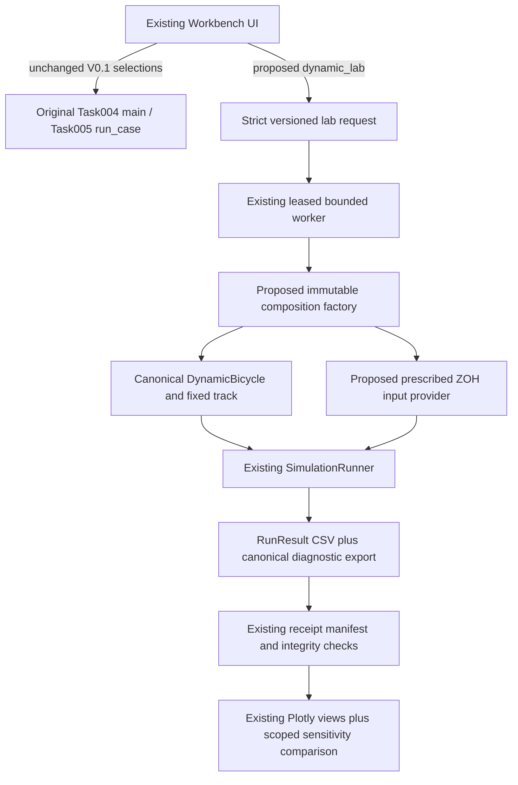

# Minimum composition adapter — proposed, not implemented

**A2 supersession:** D1–D5 policy is approved. The first release is narrowed by the
[implementation contract](IMPLEMENTATION_CONTRACT.md) to five proposed named cases and one common
seed/schedule; remaining numerical acceptance is listed in [DECISION_SUMMARY.md](DECISION_SUMMARY.md).
No free-form parameter editor is implied by the broader audited construction capability below.

Status and scientific decisions: [V0.2-A scope](README.md). Audited interfaces/defaults:
[parameter matrix](PARAMETER_CAPABILITY_MATRIX.md). No canonical source change is needed for the
recommended open-loop composition. Parameter contracts and execution remain separately gated.

## Construction and ownership

The input provider implements the existing controller protocol only to supply a predetermined
`[delta,a_cmd]` from simulation time. It ignores state for action selection. Label it **prescribed
open-loop input**, not LQR, MPC, a new feedback law or a computational controller timing study.
No controller design/prediction model is constructed by this adapter; existing LQR remains fixed.
The canonical simplified body balances omit steering-frame force rotation and retain provisional
load-scaled tire stiffness. The adapter must not add force-projection corrections or imply that a
different tire selection supplies missing suspension/actuator physics.

Proposed tool-local pieces, after authorization:

- `lab_configuration.py`: strict request shape, approved contract/case identifiers, normalized
  override/schedule metadata. Keep module imports safe for the worker's pre-numerical startup.
- `dynamic_lab.py`: lazy canonical imports after the existing resource/native controls; immutable
  construction, prescribed-input provider, call to `SimulationRunner`, export of actual results.
- Small explicit additions to existing validation/dispatch, UI, provenance, artifact registration,
  plotting and comparison. No new framework, simulation engine, dependency or broad frontend rewrite.

An effective vehicle is constructed from a captured synthetic base configuration plus an explicit
allowlisted override dictionary, using canonical `VehicleParameters`/`dataclasses.replace` and
`validate_for_dynamic()`. This creates a new immutable object; no YAML is edited. A lab request
cannot choose arbitrary config paths, injected Python components, imports or evaluation expressions.
Retain both the full base snapshot and full effective parameters actually used by the worker.

## Validation sequence

1. Strict finite SI numeric inputs, excluding booleans/coercible strings/NaN/infinity; reject unknown
   keys, null overrides, removal of inherited limits and unsupported model/schedule combinations.
   Canonical vector constructors cast to float64, so UI/request validation must not rely on their
   casts to reject every ill-typed user input.
2. Merge only approved fields into the immutable base snapshot. Call the canonical P constructor
   and dynamic-readiness gate. Preserve its exact geometry consistency check. No guessed inertia
   law, stiffness calibration or silent geometry repair.
3. Check the reviewed synthetic case/envelope contract, separately from mathematical positivity.
   Unsupported parameter/dt combinations are rejected with a reason; no force clipping, automatic
   retuning, adaptive integrator or weakened validity threshold.
4. Construct the fixed canonical track, default linear tire/no allocator and default quasi-static
   loads; call `DynamicBicycle` with fixed default low-speed guard. Do not accidentally load the
   different linear-reference allocation YAML merely because its tire law is also called linear.
5. Resolve the full canonical initial state and strict held-input schedule. Validate their shape,
   finite values, configured command limits and the initial model-domain checks through canonical
   APIs. Check command-dependent loads for the declared schedule, but do not claim those checks
   establish all future states. Canonical RK4-stage/final checks remain authoritative during motion.
6. Construct `RunConfig` with approved duration/dt, `dt_control=dt_plant`, `target_laps=None`, ideal
   modeled timing (`latency=None`) and an explicit recorded corridor-stop policy. Recommended first
   profile keeps the runner's default sampled monitoring/continue behavior, with short approved
   cases intended to stay in the corridor; no vehicle-body collision or physical stop is implied.

Initial `vx`, `vy`, `r` are independent dynamic states. Changing them must not silently change
`e_psi`, progress, lateral offset or steering to create an assumed equilibrium. The full initial
tuple is always shown and retained. An optional future derived-pose initialization mode would be
a separate, versioned, explicitly reviewed composite treatment, not a default convenience.

Neither holding `a_cmd=0` nor holding it constant holds body `vx` constant. The canonical semantics
remain `a_cmd=Fx/m` and `dvx/dt=a_cmd+r*vy`. Do not add a hidden PI speed loop or convert the input
to fixed newtons when mass is changed.

## Execution and default preservation

The V0.1 `dynamic_demo` path still calls original `main()` and `lqr_baseline` still calls original
`run_case()`. Their defaults, old request shapes, timelines, CSVs and byte-parity tests stay intact.
Changing the UI's initial selection or silently routing an existing request into the lab is forbidden.

The new lab always uses its explicitly named runner profile, including when its parameter override
map is empty. Its nominal baseline and perturbed cases share the same path. No hidden branch based
on whether an override is present is permitted in a controlled sensitivity experiment.

| Contract | Existing Task004 demo | Proposed lab using existing runner |
|---|---|---|
| Grid | `next_time=min((step+1)*dt,duration)`; final shortened step allowed | `RunConfig` requires integer plant ticks; fixed `dt_plant` per step |
| Applied inputs | Original `command(time)` sampled at step start; custom `1e-12 s` transition comparisons | Tick-indexed ZOH schedule, first segment starts at tick zero; changes at declared integer ticks |
| Final row | Re-evaluates original command at terminal time, with no following integration | Keeps the last held action; terminal control is informational |
| Diagnostics/export | Model diagnostics inline in `states.csv`; original summary | Runner state/control exports plus versioned canonical diagnostic export |

Even for numerically equivalent intended times, repeated subtraction versus a fixed dt can produce
different floating-point paths. **Do not claim byte-identical new-lab versus legacy trajectories.**
Exact V0.1 preservation means the existing accepted paths remain unchanged and retain their exact
original-entry-point parity. New-lab acceptance compares against an independently constructed call
to the same canonical runner/profile, not against altered legacy golden files.

D4 now settles this choice: use the existing runner for the new lab and preserve original V0.1
entry points. No original-demo extraction is needed or authorized. Do not copy its integration loop,
monkeypatch its factories/state conversion or modify the runner to mimic the demo silently.

The first schedule grammar is a bounded ordered list of piecewise-constant segments: tick zero
first, strictly increasing unique transition ticks within the approved horizon, finite delta/a_cmd
per segment. A transition at a terminal time has no applied interval and is rejected as a treatment.
No interpolation, time snapping, arbitrary functions, actuator dynamics, chirp generator or new
steering-rate guarantee is introduced. Existing legacy command behavior remains separately available.

## Outputs and evidence

Use `RunResult.write_csv()` for the new lab's actual state/control data. Derived XY and geometry use
the canonical track/Frenet conversion, with the composed track injected into export rather than
reconstructed from an unrelated adapter default. Keep canonical state/control order and SI units.

A small `diagnostics.csv` may re-evaluate `model.diagnostics(x,u)` at each retained sample using the
same immutable composition and its recorded held command. This calls canonical components, copies
no equations and performs no further integration. Label it **canonical diagnostics recomputed at
retained samples**; terminal values use an informational held input. Do not call finite differences
of sampled yaw rate a measured yaw acceleration. Extra rates are unnecessary for the initial lab.

Record raw runner outputs/failure information before diagnostic/geometry processing. The runner
returns last-valid-state partials for its handled model/Frenet failure classes; unexpected errors
propagate to worker failure. A guard kill during an in-memory run may retain only logs/metadata.
Never promise a recovered trajectory that was not written, fill missing rows or hide failed cases.
Keep `runner_stop_reason`/`runner_failure` (and whether integration reached its horizon) where written.
Under the existing worker contract an export exception produces a failed worker outcome even if
integration had finished; do not relabel that exit as successful. A later manifest-commit failure
after worker success retains the existing separate completed-execution/evidence-failed state.

The worker must propagate `RunResult.failure` into the existing non-success outcome path even when
the runner returns normally. Outcome, evidence validity and physical interpretation remain separate.
No new physical-validity PASS flag can be inferred merely from finite data, a zero exit code or
linear utilization below/above one.

Required successful lab artifacts include resolved composition, complete state/control outputs,
summary, geometry/XY, telemetry/units contract, diagnostic export and numerical environment, in
addition to the existing request/receipt/owner records. Register expected outputs by adapter/version;
all manifest-listed files remain required regardless of whether a graph currently selects them.
Continue using the existing manifest anchor, hash-on-consumption, atomic publication and quarantine.

Provenance must include:

- Base YAML bytes/path/hash and synthetic classification; effective canonical parameter dictionary.
- Requested overrides, inherited/explicit/derived origin of every value, and approved contract ID.
- Full resolved initial-state tuple, tire/load/allocation class identities and fixed guard values.
- Complete requested/resolved schedule, actual applied controls and tick/terminal semantics.
- Runner/adapter/schema versions, track identity/geometry hash, dt/duration, ideal timing assumptions.
- Existing Git/source/environment/native controls, immutable execution receipt, logs and file manifest.
- For comparisons, declared experiment/treatment key and all invariant/varied fields.

Worker construction must use/confirm the recorded effective snapshot, not quietly reload different
parameters from a later edited YAML. Scientific source remains stable during runs as required by
the current Workbench model; hashes record source identity, not authentication against rewriting
all records or a power-loss guarantee.

## Existing integration seams that need explicit future edits

Current `worker.execute()` and geometry export have a two-adapter dynamic/otherwise-LQR branch.
Adding a lab ID without explicit dispatch would route it incorrectly. Current `configuration.validate`,
`storage.read_request` and `required_artifacts` also recognize V0.1 shapes/expectations; they need
adapter-scoped validation/expectations, not permissive global fallthrough. `jobs.provenance()` currently
records the fixed vehicle YAML; new effective overrides must not be represented by that base alone.
The UI/plot layer must register diagnostic schema/units and new artifact ingestion explicitly.

Preserve the worker-owned lease, verified PID/birth/command/run identity, cancellation/recovery,
measurement-guard/disk checks, current kernel/sample limits and native initialization before any
numerical import. A sensitivity comparison launches serial existing jobs; no new batch scheduler,
parallel worker pool or changed execution budget is required.

## Controlled comparison without weakening V0.1

V0.1 currently treats a changed full vehicle definition as illustrative. Leave that rule and all
historical classifications unchanged. Add a **lab-only, versioned treatment contract**:

- Controlled: two complete, integrity-verified lab runs with identical scientific source, model,
  tire/load/allocation, base, track, clock/sample grid/duration, environment, state/units, limits and
  all effective fields except exactly one approved declared treatment.
- Treat a geometry-derived or multi-field change as a composite factor only if explicitly approved;
  it is not an accidental exception to the invariant comparison.
- Illustrative only: known different composition, clock, multiple unapproved changes or cross-adapter
  overlays; expose differences without causal ranking. Invalid: corrupt/unverified data, unknown
  contracts/units, failed or incomplete outcome/coverage for a controlled experiment.
- Do not remove all effective vehicle parameters from the fingerprint, round differences away or
  retroactively reseal/reclassify old records. Compare actual resolved values and applied schedules.

Retain the current two-run raw-time overlays and prediction/observation/explanation notes. An
allowlisted selection of r, vy, vx, slip, force/load and effective-stiffness channels is sufficient.
No fitting, stability certification, new analysis framework or automatic answer generation is needed.
